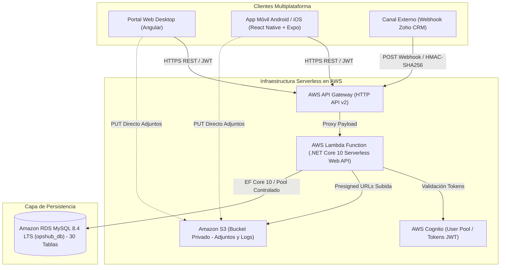

# Especificación de Arquitectura de Software: Platform Ops & Product Feedback Hub
**Proyecto:** Plataforma Centralizada de Gestión Operativa y Feedback Comercial (*TuNegocio.pe*)  
**Backend:** .NET Core 10 (C#) | Clean Architecture | AWS Lambda | AWS API Gateway  
**Base de Datos:** Amazon RDS for MySQL 8.4 LTS (`opshub_db`) | Motor InnoDB | Collation utf8mb4_unicode_ci  
**Frontend Multiplataforma:** App Móvil en React Native con Expo (SDK 58) + Portal Web en Angular  
**Almacenamiento y Seguridad:** Amazon S3 (Bucket Privado / URLs Prefirmadas) | AWS Cognito | RBAC | HTTPS/TLS  
**Institución:** Instituto de Educación Superior IDAT — VI Ciclo (Carrera de Desarrollo de Sistemas)  

---

## 1. Visión General del Sistema y Objetivos

### 1.1. Objetivo General
Diseñar e implementar una plataforma centralizada que resuelva la fragmentación operativa entre Soporte Técnico, TI/Desarrollo, Ventas y Marketing en empresas de software como servicio (SaaS), aplicando el caso específico de **TuNegocio.pe**.

La meta final consiste en erradicar la pérdida de información y la lentitud en la atención técnica mediante tres mecanismos directos:
1. **Transferencia estructurada de fallas técnicas:** Desde Soporte hacia TI/Desarrollo con trazabilidad de errores, captura de logs y adjuntos en Amazon S3.
2. **Priorización de producto basada en impacto comercial:** Clasificación de solicitudes de mejora (*Feature Requests*) según el volumen de peticiones y el valor económico de las cuentas interesadas sincronizadas desde Zoho CRM.
3. **Comunicación interna automatizada:** Emisión de avisos sobre mantenimientos del sistema, alertas de caídas de infraestructura y notas de versiones liberadas (*Changelog*) para toda la organización.

### 1.2. Objetivos Específicos
1. **Formular el diseño técnico de la plataforma:** Especificar una arquitectura desacoplada basada en Clean Architecture, servicios REST en .NET Core 10, y un modelo relacional normalizado de 30 tablas en MySQL 8.4 LTS (`opshub_db`) que organice los módulos de incidencias, cuentas comerciales, auditoría y feedback.
2. **Construir el prototipo funcional del sistema:** Desarrollar la interfaz de usuario multiplataforma (App Móvil en React Native y Portal Web en Angular) y los servicios de backend serverless para la transferencia de fallos técnicos con bloqueo optimista y clasificación de mejoras.
3. **Evaluar el funcionamiento del piloto en un entorno operativo:** Medir cuantitativamente los tiempos de escalación de tickets, el cumplimiento de SLAs y la efectividad en la priorización de nuevas funciones con personal de las cuatro áreas.

---

## 2. Arquitectura de Software y Estrategia Multiplataforma

El sistema adopta una **arquitectura desacoplada basada en servicios RESTful** bajo el patrón **Clean Architecture**, consumida por clientes multiplataforma complementarios:
* **App Móvil (React Native con Expo):** Orientada a operadores de campo, técnicos de guardia y supervisores para consulta ágil, creación de incidencias con fotos y resolución rápida en cualquier momento.
* **Portal Web (Angular):** Consola administrativa de escritorio para gestión integral de tableros Kanban, reportes analíticos pesados, configuración de roles y changelogs.



### 2.1. Comunicación en Tiempo Real y Trazabilidad
Para mantener informados a los operadores sin sobrecargar la infraestructura de servidores:
* **Server-Sent Events (SSE) / Polling Reactivo:** Notificación unidireccional de eventos críticos como caídas de servicio, tickets P1 asignados o actualizaciones de estado.
* **Trazabilidad Inmutable:** Cada cambio de estado genera un registro en la tabla `logs_actividad` y `escalaciones_ticket`, garantizando auditoría total para cumplimiento de normativas de calidad.

### 2.2. Integración con Zoho CRM mediante Webhooks
Para vincular el área de Ventas con Desarrollo sin requerir sincronizaciones periódicas costosas:
* **Endpoint Receptor:** `POST /api/v1/integrations/zoho/webhook`
* **Seguridad:** Validación de firma criptográfica en la cabecera `X-Zoho-Signature` (HMAC-SHA256).
* **Función:** Cuando ventas registra o actualiza un cliente potencial o petición comercial en Zoho CRM, el webhook envía el ID de la cuenta, el monto anual contratado y la descripción. El backend procesa el paquete y actualiza automáticamente las tablas `clientes_solicitantes` y `priorizacion_sugerencia`.

---

## 3. Infraestructura en la Nube (AWS Cloud - Esquema Optimizado)

El despliegue aprovecha la capa gratuita y componentes serverless administrados de AWS:

1. **Base de Datos Relacional (Amazon RDS for MySQL):**
   * **Motor:** MySQL Community 8.4 LTS con almacenamiento InnoDB transaccional.
   * **Instancia:** `db.t4g.micro` (Arquitectura ARM Graviton2, optimizada para cuota gratuita).
   * **Almacenamiento:** 20 GB General Purpose SSD (gp2).
   * **Juego de caracteres:** `utf8mb4` con cotejamiento `utf8mb4_unicode_ci`.
   * **Respaldos:** Snapshots automáticos con retención de 1 día.

2. **Cómputo Backend (.NET 10 en AWS Lambda + API Gateway):**
   * **Costo Cero en Inactividad:** A diferencia de servidores EC2 encendidos 24/7, Lambda solo factura durante los milisegundos que dura la ejecución de cada solicitud HTTP.
   * **Escalabilidad Automática:** Absorbe picos imprevistos de reportes durante caídas de infraestructura sin intervención manual.
   * **API Gateway HTTP API v2:** Enrutamiento de baja latencia con certificados SSL/TLS administrados automáticamente.

3. **Almacenamiento de Objetos (Amazon S3):**
   * Bucket privado para almacenamiento de evidencias multimedia, capturas de pantalla y trazas de error (*logs*).
   * **URLs Prefirmadas (Pre-signed URLs):** El backend emite URLs seguras con expiración de 5 minutos, permitiendo que la App Móvil y el Portal Web suban archivos pesados directamente a S3 sin saturar el ancho de banda del backend.

4. **Identidad y Accesos (AWS Cognito & RBAC Local):**
   * Autenticación híbrida compatible con AWS Cognito User Pools (`cognito_sub`) y hash local (BCrypt). Control de permisos granular por roles en base de datos.

---

## 4. Modelo de Datos y Control de Concurrencia (30 Tablas en 6 Módulos)

### 4.1. Mecanismo de Bloqueo Optimista (Optimistic Locking)
Para erradicar el problema de sobreescritura accidental (*Lost Update Problem*) cuando dos operadores atienden la misma incidencia simultáneamente:
* La tabla `tickets` posee la columna `version INT NOT NULL DEFAULT 1`.
* En Entity Framework Core se mapea como **Concurrency Token**: `.IsConcurrencyToken()`.
* **Mecanismo:** La aplicación móvil/web envía la versión conocida del ticket al actualizar. La sentencia SQL ejecuta:
  ```sql
  UPDATE tickets 
  SET estado_id = @estado, prioridad_id = @prioridad, version = version + 1 
  WHERE id = @id AND version = @version;
  ```
* Si otro usuario modificó el registro milisegundos antes, la condición `version = @version` no coincide, afectando 0 filas.
* El backend intercepta la excepción `DbUpdateConcurrencyException` y responde con el código **`HTTP 409 Conflict`**. La aplicación captura este error y despliega un diálogo nativo que recarga los datos sin perder información.

### 4.2. Estructura de Módulos y Entidades Relacionales

```
┌────────────────────────────────────────────────────────────────────────┐
│                        ESTRUCTURA DE MÓDULOS                           │
├───────────────────────────────────────────────────────┬────────────────┤
│ Módulo                                                │ N° de Tablas   │
├───────────────────────────────────────────────────────┼────────────────┤
│ 1. Control de Acceso, Usuarios y Organización         │ 5 tablas       │
│ 2. Clientes SaaS y Cuentas Comerciales                │ 4 tablas       │
│ 3. Gestión de Incidentes Técnicos (Core Transaccional)│ 7 tablas       │
│ 4. Solicitudes de Producto y Roadmap                  │ 5 tablas       │
│ 5. Comunicados Internos, Estado y Changelog           │ 4 tablas       │
│ 6. SLAs, Auditoría, Turnos y Notificaciones           │ 5 tablas       │
├───────────────────────────────────────────────────────┼────────────────┤
│ TOTAL                                                 │ 30 tablas      │
└───────────────────────────────────────────────────────┴────────────────┘
```

#### Módulo 1: Control de Acceso y Organización (5 tablas)
* `departamentos`: Áreas funcionales (`SOP`, `TI`, `VENTAS`, `MKT`, `OPS`).
* `roles`: Perfiles jerárquicos (`ADMIN`, `AGENTE_SOPORTE`, `DEV_INGENIERO`, `EJECUTIVO_VENTAS`, `MARKETING_LEAD`).
* `permisos`: Catálogo granular de capacidades (`TICKET_CREATE`, `TICKET_ASSIGN_DEV`, `CHANGELOG_PUBLISH`).
* `roles_permisos`: Tabla asociativa n:m para asignación de privilegios.
* `usuarios_internos`: Directorio de colaboradores con `cognito_sub`, email, password hash, rol y área.

#### Módulo 2: Clientes SaaS y Cuentas Comerciales (4 tablas)
* `planes_suscripcion`: Planes del servicio (`STARTER`, `PROFESSIONAL`, `ENTERPRISE`, `CUSTOM`) con SLAs asociados.
* `clientes_saas`: Empresas usuarias de TuNegocio.pe con RUC, razón social y estado de cuenta.
* `contactos_cliente`: Personas de contacto autorizadas por cada empresa cliente.
* `notas_cliente`: Anotaciones internas interdepartamentales sobre la cuenta comercial.

#### Módulo 3: Gestión de Incidentes Técnicos (Core Transaccional - 7 tablas)
* `prioridades`: Niveles de severidad (`P1_CRITICA`, `P2_ALTA`, `P3_MEDIA`, `P4_BAJA`) con tiempos de resolución.
* `estados_ticket`: Etapas del ciclo de vida (`NUEVO`, `EN_DIAGNOSTICO`, `EN_DESARROLLO`, `EN_QA`, `RESUELTO`, `CERRADO`).
* `categorias_incidencia`: Tipificación técnica (`FIRMA_ELECTRONICA`, `BASE_DE_DATOS`, `AUTENTICACION`, `IMPRESION`, `API`, `OTRO`).
* `tickets`: Registro principal de incidencias con código institucional correlativo (`INC-YYYY-XXXXX`), cliente, teléfono de contacto y columna `version` para bloqueo optimista.
* `ticket_comentarios`: Hilo de discusión técnica entre soporte y desarrollo.
* `ticket_adjuntos`: Registro de archivos, capturas y logs almacenados en Amazon S3.
* `escalaciones_ticket`: Historial inmutable de transferencias entre departamentos.

#### Módulo 4: Solicitudes de Producto y Roadmap (5 tablas)
* `estados_sugerencia`: Ciclo de aprobación (`EVALUACION`, `ROADMAP`, `DESARROLLO`, `DESCARTADA`, `LANZADA`).
* `sugerencias_producto`: Registro de requerimientos de nuevas funciones solicitadas por clientes.
* `votos_sugerencia`: Respaldo interno de colaboradores comerciales a peticiones específicas.
* `clientes_solicitantes`: Empresas demandantes de una mejora, con valor anual contratado sincronizado desde Zoho.
* `priorizacion_sugerencia`: Matriz ponderada de valor de negocio vs. esfuerzo de desarrollo estimado.

#### Módulo 5: Comunicados Internos, Estado y Changelog (4 tablas)
* `tipos_comunicado`: Clasificación (`INCIDENCIA_SERVICIO`, `MANTENIMIENTO_PROGRAMADO`, `COMUNICADO_GENERAL`).
* `comunicados_sistema`: Publicaciones sobre el estado operativo de los servicios.
* `destinatarios_comunicado`: Segmentación de áreas o clientes receptores.
* `anuncios_changelog`: Notas oficiales de versión de las mejoras y parches liberados a producción.

#### Módulo 6: SLAs, Auditoría, Turnos y Notificaciones (5 tablas)
* `metricas_ticket`: Tiempos calculados de primera respuesta, resolución y cumplimiento de SLA.
* `evaluaciones_atencion`: Calificación del soporte brindado (CSAT).
* `turnos_disponibilidad`: Programación de guardias y disponibilidad del personal técnico.
* `logs_actividad`: Auditoría inmutable de transacciones y cambios de estado en la base de datos.
* `notificaciones_usuario`: Mensajes y alertas dirigidas al personal interno.

---

## 5. Implementación de la Aplicación Móvil en React Native

La aplicación móvil construida en el directorio `projects/mobile/` cumple con los lineamientos del desarrollo móvil moderno y las directrices de la rúbrica académica:

### 5.1. Características Técnicas Implementadas
1. **Tipado Estricto con TypeScript:** Interfaces completas (`Ticket`, `TicketPriority`, `TicketStatus`, `TicketCategory`) en `projects/mobile/src/types/ticket.ts`.
2. **Gestión de Estado Reactivo con Hooks Obligatorios:**
   * `useState`: Para control de formularios locales, validaciones bajo el input y filtros dinámicos.
   * `useEffect`: Para carga inicial del repositorio en memoria y refresco de estadísticas.
   * `useReducer`: Máquina de estados centralizada en `TicketContext.tsx` que procesa acciones puras (`LOAD_START`, `LOAD_SUCCESS`, `ADD_TICKET`, `UPDATE_TICKET`, `DELETE_TICKET`).
   * `Context API`: Distribución global del estado y métodos CRUD sin *prop-drilling*.
3. **Flujo CRUD Completo en Memoria:**
   * **Crear:** Formulario con validaciones contextuales de color rojo bajo el input y campo de teléfono directo de contacto obligatorio.
   * **Listar:** Bandeja reactiva con buscador instantáneo por texto y barra de chips de filtro por estado.
   * **Detalle y Edición:** Modificación de estado, severidad técnica y actualización de notas.
   * **Eliminación con Confirmación:** Botón destructivo protegido con diálogo nativo `Alert.alert` que exige confirmación explícita antes de eliminar.
4. **Control de Concurrencia Optimista:** Soporte del campo `version`, botón de prueba para simular conflictos concurrentes y captura del error `HTTP 409 Conflict` con diálogo explicativo.
5. **Multiplataforma:** Ejecución nativa en dispositivos físicos y emuladores mediante **Expo Go (SDK 58)** y soporte web habilitado con `react-native-web`.
