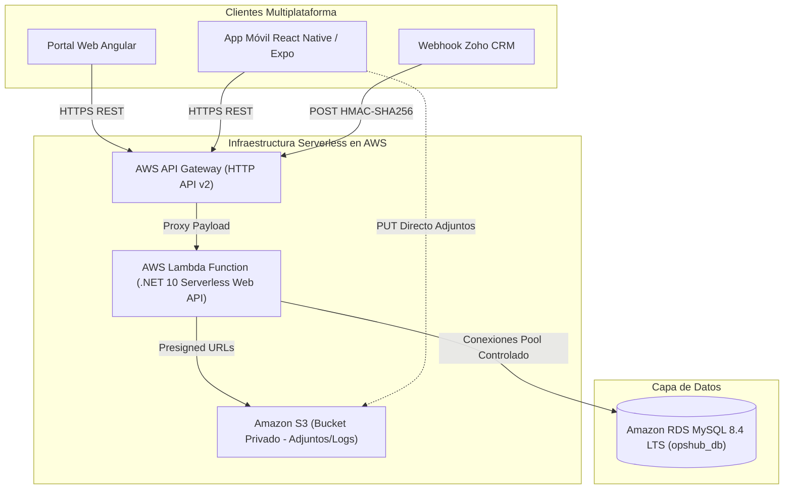

# Especificación de Arquitectura de Backend: Platform Ops & Product Feedback Hub
**Proyecto:** Plataforma Centralizada de Gestión Operativa y Feedback Comercial (*TuNegocio.pe*)  
**Tecnología:** .NET Core 10 (C#) | AWS Lambda | AWS API Gateway | MySQL 8.4 LTS (Amazon RDS)  
**Institución:** Instituto de Educación Superior IDAT — VI Ciclo (Carrera de Desarrollo de Sistemas)  
**Propósito del Documento:** Guía técnica formal para el desarrollo y manual de sustentación académica ante jurado calificador.

---

## 1. Visión General y Justificación de Arquitectura

El backend de **OpsHub** tiene la responsabilidad de orquestar la interacción operativa entre cuatro departamentos clave: **Soporte Técnico, TI/Desarrollo, Ventas y Marketing**. Se requiere un sistema robusto, transaccional y altamente mantenible que soporte interfaces multiplataforma (App Móvil en React Native y Portal Web en Angular).



### 1.1. ¿Por qué Clean Architecture (Arquitectura Limpia)?
Frente a las arquitecturas tradicionales en capas (*N-Tier* espagueti donde los controladores o la lógica de negocio se acoplan directamente a las tablas de la base de datos o a librerías de terceros), Clean Architecture establece la **Regla de Dependencia**:
* Las capas centrales (**Domain** y **Application**) no conocen nada de frameworks externos, bases de datos, librerías de AWS o controladores web.
* Las capas externas (**Infrastructure** y **Presentation/Api**) dependen hacia adentro mediante interfaces (Inversión de Dependencias).
* **Beneficio Académico y Empresarial:** Permite probar casos de uso en aislamiento con pruebas unitarias rápidas (mocks), cambiar de base de datos o de proveedor de nube sin alterar una sola línea de lógica de negocio, y garantiza código mantenible a largo plazo.

### 1.2. ¿Por qué Serverless Web API con AWS Lambda y API Gateway?
1. **Costo Cero en Inactividad:** En el esquema de cuota gratuita y proyectos académicos, una máquina virtual EC2 o un contenedor Fargate incurren en costos de cómputo continuos 24/7. Lambda solo factura los milisegundos exactos que toma procesar una solicitud.
2. **Escalabilidad Elástica Automática:** Durante caídas de servicio (picos de incidencias P1), el sistema escala horizontalmente sin intervención manual de servidores.
3. **Mantenibilidad Simplificada:** No hay sistemas operativos que actualizar, parches de seguridad que instalar ni puertos que gestionar.

---

## 2. Aplicación de los Principios SOLID

La solución demuestra el dominio de la ingeniería de software aplicando cada uno de los principios SOLID:

### 2.1. S — Single Responsibility Principle (Responsabilidad Única)
* **En el Dominio y Aplicación:** Cada clase o caso de uso resuelve un único problema de negocio. En lugar de un servicio monolítico `TicketService` con decenas de métodos, se diseñan handlers específicos (ejemplo: `CreateTicketCommandHandler`, `UpdateTicketStatusCommandHandler`, `EscalateTicketCommandHandler`).
* **En la Infraestructura:** El servicio `S3StorageService` solo se encarga de comunicarse con Amazon S3 y generar URLs prefirmadas; no valida reglas de tickets ni manipula la base de datos.

### 2.2. O — Open/Closed Principle (Abierto/Cerrado)
* Las entidades y flujos de trabajo están abiertos a extensión pero cerrados a modificación.
* **Uso de Pipeline Behaviors:** Validaciones (FluentValidation), logging y auditoría se inyectan como intermediarios en el flujo de ejecución sin modificar el código de los casos de uso.
* Para agregar una nueva regla de validación a un ticket, se crea un validador nuevo en lugar de editar el handler transaccional.

### 2.3. L — Liskov Substitution Principle (Sustitución de Liskov)
* Todas las implementaciones de repositorios y servicios externos cumplen de manera estricta los contratos definidos en sus interfaces (`IApplicationDbContext`, `IS3StorageService`, `IPasswordHasher`).
* En las pruebas unitarias, se puede sustituir la implementación real de S3 por un `MockS3StorageService` en memoria sin que la capa de aplicación experimente errores de comportamiento o efectos secundarios inesperados.

### 2.4. I — Interface Segregation Principle (Segregación de Interfaces)
* Ningún cliente o servicio está obligado a depender de interfaces gigantes con métodos que no necesita.
* Se diseñan contratos pequeños y especializados:
  * `ICurrentUserService`: Expone únicamente el `UserId`, `Email` y `Rol` del token autenticado.
  * `IS3StorageService`: Expone únicamente la generación de URLs prefirmadas.
  * En lugar de una interfaz general de notificaciones con llamadas a correo, SMS y push, se separan en componentes modulares.

### 2.5. D — Dependency Inversion Principle (Inversión de Dependencias)
* Los módulos de alto nivel (Casos de uso en `Application`) no dependen de módulos de bajo nivel (MySQL, AWS SDK en `Infrastructure`). Ambos dependen de abstracciones (interfaces en `Application/Common/Interfaces`).
* La inyección de dependencias (`Microsoft.Extensions.DependencyInjection`) en el proyecto `Api` se encarga de resolver los enlaces en tiempo de ejecución.

---

## 3. Estructura de Proyectos de la Solución (.NET 10)

```text
OpsHub.Backend/
├── 1. Core/
│   ├── OpsHub.Domain/                      # El núcleo del negocio (Puro C#)
│   │   ├── Common/                         # BaseEntity, IAuditableEntity
│   │   ├── Entities/                       # 30 Entidades organizadas por módulos
│   │   │   ├── AccessControl/              # UsuarioInterno, Rol, Permiso, Departamento, RolPermiso
│   │   │   ├── Commercial/                 # ClienteSaas, PlanSuscripcion, ContactoCliente, NotaCliente
│   │   │   ├── Incidents/                  # Ticket, Prioridad, EstadoTicket, CategoriaIncidencia,
│   │   │   │                               # TicketComentario, TicketAdjunto, EscalacionTicket
│   │   │   ├── ProductFeedback/            # SugerenciaProducto, EstadoSugerencia, VotoSugerencia,
│   │   │   │                               # ClienteSolicitante, PriorizacionSugerencia
│   │   │   ├── Announcements/              # ComunicadoSistema, TipoComunicado, DestinatarioComunicado, AnuncioChangelog
│   │   │   └── OperationsAndAudit/         # MetricaTicket, EvaluacionAtencion, TurnoDisponibilidad,
│   │   │                                   # LogActividad, NotificacionUsuario
│   │   ├── Enums/                          # CanalesOrigen, Severidades, CodigosRoles
│   │   └── Exceptions/                     # DomainException, ConcurrencyConflictException
│   │
│   └── OpsHub.Application/                 # Orquestación de Casos de Uso
│       ├── Common/
│       │   ├── Interfaces/                 # IApplicationDbContext, IS3StorageService, ICurrentUserService, ICognitoAuthService
│       │   ├── Behaviors/                  # ValidationBehavior, LoggingBehavior
│       │   ├── Models/                     # Result<T>, PaginatedList<T>
│       │   └── Exceptions/                 # NotFoundException, UnauthorizedException, ValidationException
│       ├── Features/                       # Casos de uso ordenados por funcionalidad (Vertical Slices)
│       │   ├── Auth/                       # LoginCommand, RegisterCommand, GetCurrentUserQuery
│       │   ├── Incidents/                  # CreateTicket, UpdateTicketStatus, EscalateTicket, AddComment
│       │   ├── ProductFeedback/            # CreateFeatureRequest, VoteFeature, PrioritizeFeature
│       │   ├── Announcements/              # PublishAnnouncement, GetChangelogs
│       │   └── Integrations/               # ProcessZohoWebhookCommand (Validación de firma)
│       ├── Mappings/                       # DTOs y perfiles de mapeo (Mapperly o AutoMapper)
│       └── DependencyInjection.cs
│
├── 2. External/
│   ├── OpsHub.Infrastructure/              # Base de Datos, AWS SDK y Servicios Externos
│   │   ├── Persistence/
│   │   │   ├── Context/                    # ApplicationDbContext (EF Core con Pomelo MySQL)
│   │   │   ├── Configurations/             # Mapeos Fluent API para las 30 tablas
│   │   │   └── Interceptors/               # AuditLogsInterceptor (guarda en logs_actividad)
│   │   ├── Services/
│   │   │   ├── S3StorageService.cs         # Implementación AWS S3 Pre-signed URLs
│   │   │   ├── CognitoAuthService.cs       # Implementación AWS Cognito Identity Provider (Admin API)
│   │   │   ├── PasswordHasher.cs           # BCrypt / Argon2 (respaldo local)
│   │   │   └── JwtTokenGenerator.cs        # Generación y validación de Claims JWT
│   │   └── DependencyInjection.cs
│   │
│   └── OpsHub.Api/                         # Punto de entrada Web & Lambda
│       ├── Controllers/                    # Endpoints REST (Auth, Catalogs, Tickets, Feedback, Integrations, Users)
│       ├── Middlewares/                    # ExceptionHandlingMiddleware (manejo centralizado 404, 409, 500)
│       ├── Filters/                        # ZohoSignatureFilter
│       ├── Program.cs                      # Configuración de servicios y AddAWSLambdaHosting
│       ├── appsettings.json                # Configuración base
│       └── serverless.template             # Definición SAM / CloudFormation para AWS
```

---

## 4. Patrones de Ingeniería Avanzados Implementados

### 4.1. Bloqueo Optimista (Optimistic Locking) en Tickets
* **Problema:** En situaciones críticas de soporte, dos operadores pueden abrir la misma incidencia y cambiar su estado o notas simultáneamente, sobrescribiendo el trabajo del otro (*Lost Update Problem*).
* **Solución Técnica:** La tabla `tickets` posee la columna `version INT NOT NULL DEFAULT 1`.
  * En EF Core se configura como token de concurrencia:
    ```csharp
    builder.Property(t => t.Version)
           .HasColumnName("version")
           .IsConcurrencyToken()
           .HasDefaultValue(1);
    ```
  * En cada actualización, EF Core genera la sentencia SQL atómica:
    ```sql
    UPDATE tickets 
    SET estado_id = @nuevoEstado, version = version + 1 
    WHERE id = @id AND version = @versionActual;
    ```
  * Si otro usuario modificó la fila primero, `version` habrá cambiado en la base de datos. Ninguna fila coincide, EF Core lanza `DbUpdateConcurrencyException`, y el middleware del backend intercepta el error devolviendo **`HTTP 409 Conflict`**. La aplicación cliente recibe este código y solicita refrescar los datos sin perder información.

### 4.2. Carga Segura y Eficiente de Archivos Multimedia (S3 Pre-signed URLs)
* **Problema:** Subir capturas de pantalla de fallas técnicas o archivos logs pesados a través de una función AWS Lambda causa sobrecostos en tiempo de ejecución, agota los límites de memoria de Lambda y puede provocar timeouts por tamaño de payload en API Gateway (límite estricto de 10 MB).
* **Solución Técnica:** El backend actúa únicamente como emisor de autorizaciones criptográficas temporales:
  1. El cliente móvil/web llama a `POST /api/v1/tickets/{id}/attachments/presigned-url` indicando nombre y tipo MIME del archivo.
  2. El backend genera una URL prefirmada de Amazon S3 usando el AWS SDK con expiración estricta de **5 minutos** y verbo `PUT`.
  3. El cliente sube el archivo directamente a Amazon S3 usando esa URL.
  4. Una vez completada la subida, se registra el registro en la tabla `ticket_adjuntos`.

### 4.3. Trazabilidad Inmutable con Interceptor de Auditoría (`logs_actividad`)
* Mediante un `SaveChangesInterceptor` de Entity Framework Core, cada operación `INSERT`, `UPDATE` o `DELETE` sobre tablas operativas captura automáticamente:
  * Usuario que realiza la acción (`usuario_id`).
  * Tabla afectada y el ID del registro.
  * Dirección IP de origen y plataforma (`REACT_NATIVE_ANDROID`, `ANGULAR_DESKTOP`).
  * Serialización en JSON de los valores anteriores y nuevos (`valores_anteriores_json`, `valores_nuevos_json`).
* Garantiza auditoría forense inmutable requerida para compliance y sustentación.

### 4.4. Integración Segura con Webhooks de Zoho CRM
* La comunicación con herramientas comerciales se realiza a través del endpoint `POST /api/v1/integrations/zoho/webhook`.
* La seguridad se valida mediante una firma criptográfica compartida en la cabecera `X-Zoho-Signature` (cálculo HMAC-SHA256 del payload recibido). Si la firma no coincide, la petición se rechaza con `HTTP 401 Unauthorized`.

### 4.5. Autenticación Híbrida y Transacción Compensatoria (Saga Pattern) con AWS Cognito
* **Problema:** En sistemas distribuidos donde la identidad se delega a un Identity Provider gestionado en la nube (AWS Cognito User Pool) y los datos operativos residen en una base de datos relacional (Amazon RDS MySQL), **no es posible utilizar una transacción ACID distribuida tradicional (2PC)**. Si el usuario se crea en Cognito pero el guardado en MySQL falla por timeout, caída de red o violación de integridad, el sistema quedaría en un estado inconsistente con un "usuario fantasma" o huérfano en Cognito.
* **Solución Técnica (Compensating Transaction):**
  1. **Pre-validación en MySQL:** Antes de contactar a Cognito, `AuthService.RegisterAsync` valida que el correo no esté duplicado y que el departamento y rol existan y estén activos. Si falla, jamás se invoca a Cognito.
  2. **Aprovisionamiento en Cognito:** Se invoca `AdminCreateUserAsync` y `AdminSetUserPasswordAsync` con contraseña permanente (evitando el estado bloqueante `FORCE_CHANGE_PASSWORD`), recuperando el `cognito_sub` inmutable.
  3. **Persistencia Transaccional en MySQL:** En un bloque `try`, se persiste el `UsuarioInterno` vinculando su `CognitoSub`.
  4. **Compensación Inmediata (Rollback Distribuido):** Si `SaveChangesAsync` arroja cualquier excepción, el bloque `catch` ejecuta:
     ```csharp
     await _cognitoAuthService.DeleteUserAsync(request.Email, CancellationToken.None);
     ```
     Cognito ejecuta `AdminDeleteUserAsync` eliminando el registro de identidad creado milisegundos antes, garantizando consistencia eventual estricta sin registros huérfanos. Se utiliza `CancellationToken.None` para asegurar la finalización del borrado incluso si el cliente canceló su petición HTTP.
  5. **Doble Factor de Respaldo:** El sistema almacena además un hash local seguro con BCrypt (`PasswordHash`), permitiendo que si AWS Cognito sufriera una degradación de servicio regional, los operadores puedan continuar autenticándose localmente sin interrupción operativa.

### 4.6. Onboarding Seguro Multiplataforma y Prevención de Escalación de Privilegios (OWASP Top 1)
* **Problema:** Permitir que usuarios anónimos envíen un `RolId` arbitrario en el formulario de registro de la Web o la App Móvil abre una brecha crítica de **Escalación de Privilegios (CWE-269 / Broken Access Control)**, donde un atacante podría autoasignarse el rol de `ADMIN`. Por otro lado, proteger los catálogos organizacionales detrás de autenticación impedía a la interfaz cliente poblar los combos desplegables para usuarios nuevos.
* **Solución Técnica:**
  1. **Catálogo Organizacional Público:** Se implementa `GET /api/v1/catalogs/departamentos` con `[AllowAnonymous]` en `CatalogsController`, permitiendo que la Web y la App Móvil consulten la estructura de la empresa de forma pública y sin requerir un token JWT previo.
  2. **Desacoplamiento de Roles en Registro:** El modelo `RegisterRequest` define `RolId` como opcional (`int?`). El usuario que se auto-registra **solo elige su departamento**.
  3. **Asignación de Rol Base en Servidor:** `AuthService` asigna automáticamente el rol base de menor privilegio correspondiente según el área:
     * Departamento TI $\rightarrow$ Rol `Ingeniero de Software / TI` (`DEV_INGENIERO`).
     * Departamento Ventas $\rightarrow$ Rol `Ejecutivo de Ventas` (`EJECUTIVO_VENTAS`).
     * Departamento Marketing $\rightarrow$ Rol `Líder de Producto & Marketing` (`MARKETING_LEAD`).
     * Otros Departamentos $\rightarrow$ Rol base `Agente de Soporte` (`AGENTE_SOPORTE`).
  4. **Promoción Administrativa:** Los roles con permisos elevados (`ADMIN`) solo pueden ser otorgados posteriormente por un Administrador existente mediante los endpoints administrativos de `UsersController`.
  5. **Endpoint de Identidad y Estado de Sesión (`GET /api/v1/auth/me`):**
     * Permite que Angular y React Native resuelvan quién es el usuario conectado a partir de su token JWT sin exponer IDs en la URL (prevención de vulnerabilidades IDOR).
     * Recupera la sesión automáticamente tras recargar la página (F5) o abrir la app móvil.
     * Retorna la lista de permisos activos (`permisos: [...]`) para que el frontend configure dinámicamente qué botones y rutas habilitar mediante *Guards* y directivas estructurales.
     * Si un usuario es revocado o desactivado en base de datos (`is_active = false`), `/me` corta el acceso inmediatamente aunque el token JWT del cliente no haya expirado.

### 4.7. Blindaje de Control de Acceso Basado en Roles (RBAC) en `UsersController`
* **Vulnerabilidad Prevenida (OWASP Broken Access Control):** En aplicaciones empresariales, un usuario autenticado con rol regular (ej. Desarrollador, Soporte o Ventas) no debe tener la facultad de mutar la estructura organizacional (crear departamentos, registrar colaboradores o alternar el estado activo de cuentas).
* **Solución Técnica:**
  * En `UsersController.cs`, los endpoints de mutación administrativa se decoraron con `[Authorize(Roles = "ADMIN")]`:
    * `POST /api/v1/users`: Registro administrativo de nuevos usuarios internos con asignación de rol privilegiado.
    * `PUT /api/v1/users/{id}/status`: Activación/desactivación de cuentas de colaboradores.
    * `POST /api/v1/users/departments`: Creación de nuevos departamentos organizacionales.
  * Se implementaron validaciones imperativas complementarias `User.IsInRole("ADMIN")` que emiten de inmediato `HTTP 403 Forbidden` (`ApiResponse<object>.Fail("No tiene privilegios para realizar esta acción.")`) en caso de accesos no autorizados.

### 4.8. Telemetría Cloud en Vivo (`/health`) y Desglose de SLAs por Plan SaaS (`/operations`)
* **Monitoreo Continuo de Infraestructura AWS (`GET /api/v1/health`):**
  * El controlador `HealthController` realiza una prueba de conexión en caliente contra Amazon RDS MySQL 8.4 LTS mediante `_context.CanConnectAsync()`, midiendo los milisegundos reales de ida y vuelta con `System.Diagnostics.Stopwatch`.
  * Expone la telemetría dinámica de los 6 componentes cloud legítimos que sustentan la solución en la región **`us-east-2 (Ohio)`**:
    1. `rds-mysql`: Amazon RDS MySQL 8.4 Multi-AZ (Base de datos relacional con réplica y pool optimizado).
    2. `lambda-api`: AWS Lambda .NET 10 (Microservicios serverless en runtime provided.al2023).
    3. `api-gateway`: Amazon API Gateway v2 HTTP API (Enrutador serverless de baja latencia que balancea hacia Lambda).
    4. `s3-storage`: Amazon S3 Storage (Depósito de evidencias y comprobantes con cifrado SSE-S3).
    5. `cloudfront-cdn`: Amazon CloudFront CDN (Distribución global con compresión Brotli y Edge Locations).
    6. `sse-eventstream`: Canal SSE EventStream en Tiempo Real (Transmisión reactiva de alertas).
  * **Cero Métricas Simuladas:** Se erradicaron entradas artificiales de servicios externos ajenos a AWS (como SUNAT), garantizando total coherencia técnica entre la arquitectura física en la nube y el reporte de la API.
* **Cálculo y Desglose Contractual de SLAs (`GET /api/v1/operations/metrics/sla`):**
  * `OperationsService.GetSlaMetricsSummaryAsync` consulta las entidades `MetricaTicket`, `Ticket`, `ClienteSaas` y `PlanSuscripcion` en MySQL.
  * Agrupa y calcula dinámicamente el cumplimiento porcentual y MTTR (Mean Time to Resolution) por cada nivel de suscripción (`ENTERPRISE` con SLA 4h, `PROFESSIONAL` con SLA 24h, `STARTER` con SLA 48h, `CUSTOM` con SLA 2h), entregando un objeto `List<PlanSlaBreakdownDto>` en el campo `DesglosePorPlan`.

---

## 5. Estrategia de Infraestructura y Seguridad en AWS

### 5.1. Gestión de Credenciales y Principio de Menor Privilegio
* **Cero Credenciales Estáticas en Código o Variables:** A diferencia de entornos tradicionales donde se colocan `AWS_ACCESS_KEY_ID` y `AWS_SECRET_ACCESS_KEY`, en AWS Lambda se utiliza un **IAM Execution Role**.
* El AWS SDK para .NET obtiene automáticamente credenciales temporales y rotativas desde el entorno de ejecución de Lambda.
* Políticas mínimas asignadas al rol:
  * `s3:PutObject` y `s3:GetObject` únicamente en el bucket `opshub-adjuntos-*`.
  * `cognito-idp:AdminCreateUser`, `cognito-idp:AdminSetUserPassword`, `cognito-idp:AdminInitiateAuth`, `cognito-idp:AdminDeleteUser`, `cognito-idp:AdminGetUser` acotados al User Pool `opshub-user-pool`.
  * `logs:CreateLogGroup`, `logs:CreateLogStream`, `logs:PutLogEvents` para CloudWatch.

### 5.2. Variables de Entorno en AWS Lambda
Las credenciales propias de la aplicación se gestionan en **Lambda → Configuration → Environment variables** (cifradas en reposo con AWS KMS):
* `ConnectionStrings__DefaultConnection`: Cadena de conexión hacia Amazon RDS MySQL.
* `JwtSettings__SecretKey`: Llave simétrica de al menos 256 bits para firma de tokens JWT.
* `JwtSettings__Issuer`: Identificador del emisor del token (`OpsHubApi`).
* `JwtSettings__Audience`: Destinatarios autorizados del token (`OpsHubClients`).
* `AWS__Cognito__UserPoolId`: ID del User Pool de AWS Cognito en la región (`us-east-2_5QCZKDuMi`).
* `AWS__Cognito__ClientId`: ID de la aplicación cliente de Cognito sin secreto (`t4jlbvlo4pt244cnige95a5q0`).
* `AWS__Cognito__Region`: Región de despliegue de Cognito (`us-east-2`).
* `AWS__BucketName`: Nombre del depósito privado de Amazon S3 (`opshub-adjuntos-prod`).
* `Zoho__WebhookSecret`: Clave secreta para validación de webhooks.

### 5.3. Prevención de Saturación de Conexiones a MySQL (Pool Tuning)
Las bases de datos relacionales en instancias pequeñas como `db.t4g.micro` soportan un número limitado de conexiones concurrentes (~60–80). Para evitar que múltiples invocaciones de Lambda agoten el pool:
* Cadena de conexión optimizada:
  ```text
  Server=...;Database=opshub_db;Uid=...;Pwd=...;Pooling=true;MinPoolSize=0;MaxPoolSize=3;ConnectionLifeTime=180;ConnectionTimeout=15;
  ```
* `MinPoolSize=0`: No retiene conexiones ociosas cuando no hay tráfico.
* `MaxPoolSize=3`: Limita el número de conexiones simultáneas por contenedor de Lambda.

### 5.4. Infraestructura como Código (IaC) con AWS SAM y CloudFormation
La infraestructura serverless completa se define en `projects/backend/src/OpsHub.Api/serverless.template` utilizando **AWS Serverless Application Model (SAM)**:
* **AWS API Gateway (HTTP API v2):** Se utiliza la versión moderna HTTP API con Payload Format Version 2.0. Proporciona ~10 ms de latencia (vs ~35 ms de REST API tradicional) y reduce los costos en un 70%.
* **Configuración CORS Centralizada:** Habilitado para orígenes cruzados (`*`) permitiendo cabeceras requeridas (`Authorization`, `Content-Type`, `X-Zoho-Signature`, `X-Client-Platform`).
* **Enrutamiento Codicioso (Greedy Proxy):** Captura todas las peticiones bajo `ANY /` y `ANY /{proxy+}` derivándolas al motor de enrutamiento interno de ASP.NET Core.
* **Políticas IAM de Mínimo Privilegio:** Rol de ejecución exclusivo con permisos para CloudWatch Logs (`AWSLambdaBasicExecutionRole`) y permisos `s3:GetObject` y `s3:PutObject` acotados al bucket de adjuntos.

### 5.5. Mitigación de Arranque en Frío (Cold Start)
Para garantizar tiempos de respuesta sub-segundo incluso en invocaciones iniciales:
1. **Publicación Self-Contained para Linux (`linux-x64`):** El binario se publica empaquetando el runtime .NET 10 optimizado con el archivo de inicio `bootstrap`, eliminando la necesidad de capas (layers) externas y reduciendo la inicialización.
2. **Dimensionamiento de Memoria (1024 MB):** En AWS Lambda, la asignación de vCPU es directamente proporcional a la memoria. Asignar 1024 MB otorga un núcleo de CPU completo a la función durante el arranque.
3. **Mapeo Liviano de Dependencias:** El registro de servicios en Clean Architecture utiliza inyecciones `AddScoped` y `AddSingleton` evaluadas perezosamente (lazy initialization).

### 5.6. Guía de Empaquetado y Despliegue

```bash
# Opción 1: Empaquetado automatizado con el script de PowerShell
.\projects\backend\deploy-lambda.ps1 -Action Package -Stage prod

# Opción 2: Despliegue automatizado con AWS SAM CLI
sam build -t projects/backend/src/OpsHub.Api/serverless.template
sam deploy --guided

# Opción 3: Actualización directa de código mediante AWS CLI
aws lambda update-function-code \
    --function-name opshub-backend-prod \
    --zip-file fileb://projects/backend/bin/opshub-backend-lambda.zip
```

---

## 6. Guía de Sustentación para el Jurado Calificador (IDAT VI Ciclo)

### Preguntas Técnicas Frecuentes y Respuestas de Defensa

#### 1. ¿Por qué eligieron Clean Architecture en lugar de una arquitectura típica de 3 capas?
> *"En una arquitectura de 3 capas tradicional, la capa de negocio suele estar fuertemente acoplada a Entity Framework y a la base de datos física. En Clean Architecture, invertimos esa dependencia: el dominio y las reglas de negocio son totalmente independientes de la infraestructura. Esto nos permite simular pruebas unitarias sin levantar MySQL, proteger el sistema de cambios externos y cumplir rigurosamente con los principios SOLID."*

#### 2. ¿Cómo solucionaron el problema de concurrencia cuando dos agentes atienden el mismo ticket?
> *"Implementamos el patrón de Bloqueo Optimista (Optimistic Locking) mediante una columna `version` en la tabla `tickets`. Cuando un cliente actualiza un ticket, la sentencia SQL valida atómicamente que la versión coincida con la que leyó originalmente e incrementa el contador. Si otro operador modificó el ticket milisegundos antes, la sentencia afecta 0 filas, el backend captura la excepción de EF Core y emite un `HTTP 409 Conflict`, impidiendo que se sobrescriban notas de soporte sin previo aviso."*

#### 3. ¿Por qué usar URLs prefirmadas de Amazon S3 en vez de recibir el archivo en la API y guardarlo?
> *"Las funciones serverless como AWS Lambda tienen limitaciones de tiempo de ejecución (timeout), costos asociados a la duración del proceso y API Gateway tiene un límite estricto de 10 MB por payload. Si enviamos imágenes de alta resolución a través de la API, sobrecargamos la memoria de la función y aumentamos costos. Con URLs prefirmadas, el backend solo genera un enlace firmado criptográficamente de 5 minutos, y la app móvil sube el archivo directo a S3, logrando máxima eficiencia y escalabilidad."*

#### 4. ¿Cómo manejan la seguridad de las credenciales de base de datos y AWS?
> *"Aplicamos el principio de menor privilegio. Para los servicios de AWS, no utilizamos contraseñas ni claves de acceso estáticas; la función Lambda asume un rol de IAM con credenciales temporales gestionadas por la nube. Para la conexión a MySQL y el secreto de firma JWT, se inyectan como variables de entorno cifradas en reposo mediante AWS KMS en la consola de Lambda, sin que ningún dato sensible resida en el repositorio de código."*

#### 5. ¿Por qué desplegar un Web API completo en AWS Lambda en lugar de una función por cada endpoint?
> *"Optamos por el patrón Serverless Web API (Monolito en Lambda con `Amazon.Lambda.AspNetCoreServer.Hosting`). Dividir 31 endpoints en 31 funciones Lambda individuales aumentaría drásticamente los arranques en frío (cold starts), multiplicaría la complejidad de despliegue y fragmentaría el código. Al albergar el Web API en una función Lambda optimizada con HTTP API v2, los contenedores calientes se reutilizan para cualquier endpoint, compartimos el pool de conexiones a MySQL y mantenemos la solución bajo Clean Architecture estándar de la industria."*

#### 6. ¿Cómo auditan los cambios críticos en la base de datos para cumplimiento normativo?
> *"Implementamos un interceptor automático en EF Core (`AuditLogsInterceptor`). Cada vez que se confirma una transacción (`SaveChangesAsync`), el interceptor inspecciona el ChangeTracker, identifica las entidades creadas, editadas o eliminadas, enmascara credenciales por seguridad y registra en la tabla `logs_actividad` el usuario, la IP, la plataforma y los estados en JSON (`valores_anteriores_json` y `valores_nuevos_json`), garantizando trazabilidad forense sin intervención manual en los controladores."*

#### 7. ¿Cómo integraron AWS Cognito con MySQL y cómo aseguran consistencia si la base de datos falla al guardar?
> *"Implementamos el patrón de Transacción Compensatoria (Saga Pattern). AWS Cognito y Amazon RDS MySQL son sistemas distribuidos independientes que no admiten una transacción ACID combinada. Al registrar un usuario, primero validamos en MySQL que los datos organizacionales sean correctos, luego creamos la identidad en Cognito recuperando el `cognito_sub`. Inmediatamente dentro de un bloque try guardamos en MySQL; si la base de datos falla por cualquier error, el bloque catch intercepta la excepción y llama a `AdminDeleteUserAsync` en Cognito con `CancellationToken.None`, destruyendo el usuario recién creado para garantizar cero registros huérfanos e inconsistencias."*

#### 8. ¿Cómo diseñaron el registro en clientes evitando que un usuario se autoasigne privilegios de Administrador?
> *"Para prevenir vulnerabilidades críticas de Escalación de Privilegios (OWASP Top 1 / Broken Access Control), el formulario de registro de la Web y App Móvil no permite que el usuario elija su rol. Expusimos un catálogo público `GET /api/v1/catalogs/departamentos` para que el colaborador solo elija su departamento organizacional, y el backend asigna automáticamente en el servidor el rol base correspondiente (ej. Agente de Soporte o Ingeniero de Software). Los roles de privilegio elevado como Administrador solo pueden ser concedidos posteriormente por otro administrador autenticado desde el módulo de gestión de usuarios."*

#### 9. ¿Para qué sirve el endpoint `GET /api/v1/auth/me` y qué rol cumple en Angular y React Native?
> *"El endpoint `/me` resuelve la identidad del usuario a partir del token JWT firmado en la cabecera Authorization sin enviar IDs en la URL, previniendo brechas de referencias directas a objetos (IDOR). En Angular y React Native cumple tres roles vitales: primero, restaurar la sesión del usuario al recargar la página (F5) o abrir la app móvil sin pedir contraseña; segundo, devolver la matriz de permisos RBAC para que el frontend active u oculte dinámicamente botones y vistas protegidas; y tercero, verificar en tiempo real que el usuario siga activo en la base de datos, revocando el acceso al instante si fue suspendido."*
