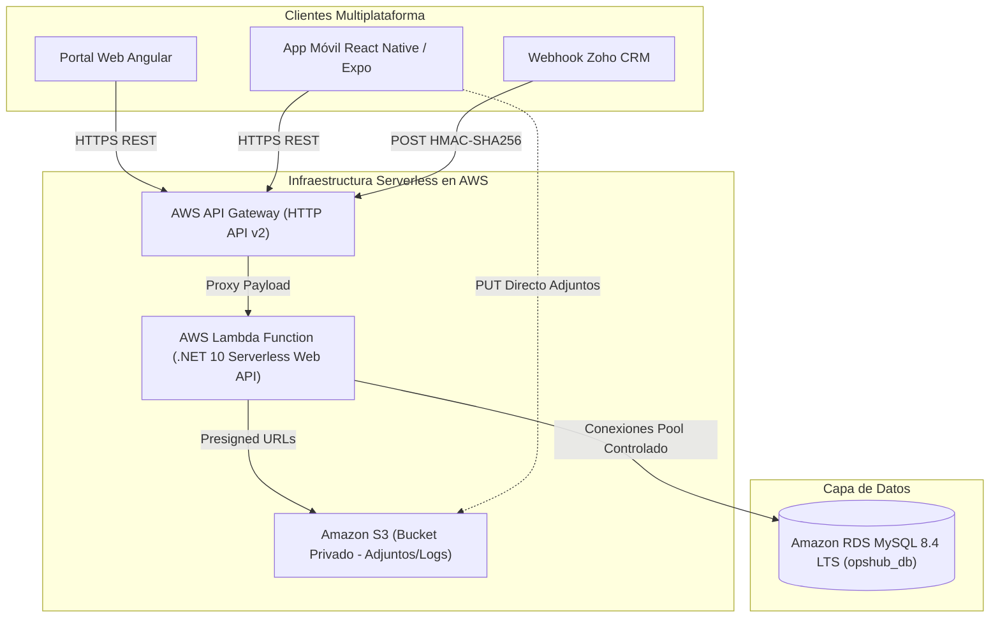

# Especificación de Arquitectura de Backend: Platform Ops & Product Feedback Hub
**Proyecto:** Plataforma Centralizada de Gestión Operativa y Feedback Comercial (*TuNegocio.pe*)  
**Tecnología:** .NET Core 10 (C#) | AWS Lambda | AWS API Gateway | MySQL 8.4 LTS (Amazon RDS)  
**Institución:** Instituto de Educación Superior IDAT — VI Ciclo (Carrera de Desarrollo de Sistemas)  
**Propósito del Documento:** Guía técnica formal para el desarrollo y manual de sustentación académica ante jurado calificador.

---

## 1. Visión General y Justificación de Arquitectura

El backend de **OpsHub** tiene la responsabilidad de orquestar la interacción operativa entre cuatro departamentos clave: **Soporte Técnico, TI/Desarrollo, Ventas y Marketing**. Se requiere un sistema robusto, transaccional y altamente mantenible que soporte interfaces multiplataforma (App Móvil en React Native y Portal Web en Angular).



### 1.1. ¿Por qué Clean Architecture (Arquitectura Limpia)?
Frente a las arquitecturas tradicionales en capas (*N-Tier* espagueti donde los controladores o la lógica de negocio se acoplan directamente a las tablas de la base de datos o a librerías de terceros), Clean Architecture establece la **Regla de Dependencia**:
* Las capas centrales (**Domain** y **Application**) no conocen nada de frameworks externos, bases de datos, librerías de AWS o controladores web.
* Las capas externas (**Infrastructure** y **Presentation/Api**) dependen hacia adentro mediante interfaces (Inversión de Dependencias).
* **Beneficio Académico y Empresarial:** Permite probar casos de uso en aislamiento con pruebas unitarias rápidas (mocks), cambiar de base de datos o de proveedor de nube sin alterar una sola línea de lógica de negocio, y garantiza código mantenible a largo plazo.

### 1.2. ¿Por qué Serverless Web API con AWS Lambda y API Gateway?
1. **Costo Cero en Inactividad:** En el esquema de cuota gratuita y proyectos académicos, una máquina virtual EC2 o un contenedor Fargate incurren en costos de cómputo continuos 24/7. Lambda solo factura los milisegundos exactos que toma procesar una solicitud.
2. **Escalabilidad Elástica Automática:** Durante caídas de servicio (picos de incidencias P1), el sistema escala horizontalmente sin intervención manual de servidores.
3. **Mantenibilidad Simplificada:** No hay sistemas operativos que actualizar, parches de seguridad que instalar ni puertos que gestionar.

---

## 2. Aplicación de los Principios SOLID

La solución demuestra el dominio de la ingeniería de software aplicando cada uno de los principios SOLID:

### 2.1. S — Single Responsibility Principle (Responsabilidad Única)
* **En el Dominio y Aplicación:** Cada clase o caso de uso resuelve un único problema de negocio. En lugar de un servicio monolítico `TicketService` con decenas de métodos, se diseñan handlers específicos (ejemplo: `CreateTicketCommandHandler`, `UpdateTicketStatusCommandHandler`, `EscalateTicketCommandHandler`).
* **En la Infraestructura:** El servicio `S3StorageService` solo se encarga de comunicarse con Amazon S3 y generar URLs prefirmadas; no valida reglas de tickets ni manipula la base de datos.

### 2.2. O — Open/Closed Principle (Abierto/Cerrado)
* Las entidades y flujos de trabajo están abiertos a extensión pero cerrados a modificación.
* **Uso de Pipeline Behaviors:** Validaciones (FluentValidation), logging y auditoría se inyectan como intermediarios en el flujo de ejecución sin modificar el código de los casos de uso.
* Para agregar una nueva regla de validación a un ticket, se crea un validador nuevo en lugar de editar el handler transaccional.

### 2.3. L — Liskov Substitution Principle (Sustitución de Liskov)
* Todas las implementaciones de repositorios y servicios externos cumplen de manera estricta los contratos definidos en sus interfaces (`IApplicationDbContext`, `IS3StorageService`, `IPasswordHasher`).
* En las pruebas unitarias, se puede sustituir la implementación real de S3 por un `MockS3StorageService` en memoria sin que la capa de aplicación experimente errores de comportamiento o efectos secundarios inesperados.

### 2.4. I — Interface Segregation Principle (Segregación de Interfaces)
* Ningún cliente o servicio está obligado a depender de interfaces gigantes con métodos que no necesita.
* Se diseñan contratos pequeños y especializados:
  * `ICurrentUserService`: Expone únicamente el `UserId`, `Email` y `Rol` del token autenticado.
  * `IS3StorageService`: Expone únicamente la generación de URLs prefirmadas.
  * En lugar de una interfaz general de notificaciones con llamadas a correo, SMS y push, se separan en componentes modulares.

### 2.5. D — Dependency Inversion Principle (Inversión de Dependencias)
* Los módulos de alto nivel (Casos de uso en `Application`) no dependen de módulos de bajo nivel (MySQL, AWS SDK en `Infrastructure`). Ambos dependen de abstracciones (interfaces en `Application/Common/Interfaces`).
* La inyección de dependencias (`Microsoft.Extensions.DependencyInjection`) en el proyecto `Api` se encarga de resolver los enlaces en tiempo de ejecución.

---

## 3. Estructura de Proyectos de la Solución (.NET 10)

```text
OpsHub.Backend/
├── 1. Core/
│   ├── OpsHub.Domain/                      # El núcleo del negocio (Puro C#)
│   │   ├── Common/                         # BaseEntity, IAuditableEntity
│   │   ├── Entities/                       # 30 Entidades organizadas por módulos
│   │   │   ├── AccessControl/              # UsuarioInterno, Rol, Permiso, Departamento, RolPermiso
│   │   │   ├── Commercial/                 # ClienteSaas, PlanSuscripcion, ContactoCliente, NotaCliente
│   │   │   ├── Incidents/                  # Ticket, Prioridad, EstadoTicket, CategoriaIncidencia,
│   │   │   │                               # TicketComentario, TicketAdjunto, EscalacionTicket
│   │   │   ├── ProductFeedback/            # SugerenciaProducto, EstadoSugerencia, VotoSugerencia,
│   │   │   │                               # ClienteSolicitante, PriorizacionSugerencia
│   │   │   ├── Announcements/              # ComunicadoSistema, TipoComunicado, DestinatarioComunicado, AnuncioChangelog
│   │   │   └── OperationsAndAudit/         # MetricaTicket, EvaluacionAtencion, TurnoDisponibilidad,
│   │   │                                   # LogActividad, NotificacionUsuario
│   │   ├── Enums/                          # CanalesOrigen, Severidades, CodigosRoles
│   │   └── Exceptions/                     # DomainException, ConcurrencyConflictException
│   │
│   └── OpsHub.Application/                 # Orquestación de Casos de Uso
│       ├── Common/
│       │   ├── Interfaces/                 # IApplicationDbContext, IS3StorageService, ICurrentUserService
│       │   ├── Behaviors/                  # ValidationBehavior, LoggingBehavior
│       │   ├── Models/                     # Result<T>, PaginatedList<T>
│       │   └── Exceptions/                 # NotFoundException, UnauthorizedException, ValidationException
│       ├── Features/                       # Casos de uso ordenados por funcionalidad (Vertical Slices)
│       │   ├── Auth/                       # LoginCommand, RegisterCommand, GetCurrentUserQuery
│       │   ├── Incidents/                  # CreateTicket, UpdateTicketStatus, EscalateTicket, AddComment
│       │   ├── ProductFeedback/            # CreateFeatureRequest, VoteFeature, PrioritizeFeature
│       │   ├── Announcements/              # PublishAnnouncement, GetChangelogs
│       │   └── Integrations/               # ProcessZohoWebhookCommand (Validación de firma)
│       ├── Mappings/                       # DTOs y perfiles de mapeo (Mapperly o AutoMapper)
│       └── DependencyInjection.cs
│
├── 2. External/
│   ├── OpsHub.Infrastructure/              # Base de Datos, AWS SDK y Servicios Externos
│   │   ├── Persistence/
│   │   │   ├── Context/                    # ApplicationDbContext (EF Core con Pomelo MySQL)
│   │   │   ├── Configurations/             # Mapeos Fluent API para las 30 tablas
│   │   │   └── Interceptors/               # AuditLogsInterceptor (guarda en logs_actividad)
│   │   ├── Services/
│   │   │   ├── S3StorageService.cs         # Implementación AWS S3 Pre-signed URLs
│   │   │   ├── PasswordHasher.cs           # BCrypt / Argon2
│   │   │   └── JwtTokenGenerator.cs        # Generación y validación de Claims JWT
│   │   └── DependencyInjection.cs
│   │
│   └── OpsHub.Api/                         # Punto de entrada Web & Lambda
│       ├── Controllers/                    # Endpoints REST (Auth, Tickets, Feedback, Integrations)
│       ├── Middlewares/                    # ExceptionHandlingMiddleware (manejo centralizado 404, 409, 500)
│       ├── Filters/                        # ZohoSignatureFilter
│       ├── Program.cs                      # Configuración de servicios y AddAWSLambdaHosting
│       ├── appsettings.json                # Configuración base
│       └── serverless.template             # Definición SAM / CloudFormation para AWS
```

---

## 4. Patrones de Ingeniería Avanzados Implementados

### 4.1. Bloqueo Optimista (Optimistic Locking) en Tickets
* **Problema:** En situaciones críticas de soporte, dos operadores pueden abrir la misma incidencia y cambiar su estado o notas simultáneamente, sobrescribiendo el trabajo del otro (*Lost Update Problem*).
* **Solución Técnica:** La tabla `tickets` posee la columna `version INT NOT NULL DEFAULT 1`.
  * En EF Core se configura como token de concurrencia:
    ```csharp
    builder.Property(t => t.Version)
           .HasColumnName("version")
           .IsConcurrencyToken()
           .HasDefaultValue(1);
    ```
  * En cada actualización, EF Core genera la sentencia SQL atómica:
    ```sql
    UPDATE tickets 
    SET estado_id = @nuevoEstado, version = version + 1 
    WHERE id = @id AND version = @versionActual;
    ```
  * Si otro usuario modificó la fila primero, `version` habrá cambiado en la base de datos. Ninguna fila coincide, EF Core lanza `DbUpdateConcurrencyException`, y el middleware del backend intercepta el error devolviendo **`HTTP 409 Conflict`**. La aplicación cliente recibe este código y solicita refrescar los datos sin perder información.

### 4.2. Carga Segura y Eficiente de Archivos Multimedia (S3 Pre-signed URLs)
* **Problema:** Subir capturas de pantalla de fallas técnicas o archivos logs pesados a través de una función AWS Lambda causa sobrecostos en tiempo de ejecución, agota los límites de memoria de Lambda y puede provocar timeouts por tamaño de payload en API Gateway (límite estricto de 10 MB).
* **Solución Técnica:** El backend actúa únicamente como emisor de autorizaciones criptográficas temporales:
  1. El cliente móvil/web llama a `POST /api/v1/tickets/{id}/attachments/presigned-url` indicando nombre y tipo MIME del archivo.
  2. El backend genera una URL prefirmada de Amazon S3 usando el AWS SDK con expiración estricta de **5 minutos** y verbo `PUT`.
  3. El cliente sube el archivo directamente a Amazon S3 usando esa URL.
  4. Una vez completada la subida, se registra el registro en la tabla `ticket_adjuntos`.

### 4.3. Trazabilidad Inmutable con Interceptor de Auditoría (`logs_actividad`)
* Mediante un `SaveChangesInterceptor` de Entity Framework Core, cada operación `INSERT`, `UPDATE` o `DELETE` sobre tablas operativas captura automáticamente:
  * Usuario que realiza la acción (`usuario_id`).
  * Tabla afectada y el ID del registro.
  * Dirección IP de origen y plataforma (`REACT_NATIVE_ANDROID`, `ANGULAR_DESKTOP`).
  * Serialización en JSON de los valores anteriores y nuevos (`valores_anteriores_json`, `valores_nuevos_json`).
* Garantiza auditoría forense inmutable requerida para compliance y sustentación.

### 4.4. Integración Segura con Webhooks de Zoho CRM
* La comunicación con herramientas comerciales se realiza a través del endpoint `POST /api/v1/integrations/zoho/webhook`.
* La seguridad se valida mediante una firma criptográfica compartida en la cabecera `X-Zoho-Signature` (cálculo HMAC-SHA256 del payload recibido). Si la firma no coincide, la petición se rechaza con `HTTP 401 Unauthorized`.

---

## 5. Estrategia de Infraestructura y Seguridad en AWS

### 5.1. Gestión de Credenciales y Principio de Menor Privilegio
* **Cero Credenciales Estáticas en Código o Variables:** A diferencia de entornos tradicionales donde se colocan `AWS_ACCESS_KEY_ID` y `AWS_SECRET_ACCESS_KEY`, en AWS Lambda se utiliza un **IAM Execution Role**.
* El AWS SDK para .NET obtiene automáticamente credenciales temporales y rotativas desde el entorno de ejecución de Lambda.
* Políticas mínimas asignadas al rol:
  * `s3:PutObject` y `s3:GetObject` únicamente en el bucket `opshub-adjuntos-*`.
  * `logs:CreateLogGroup`, `logs:CreateLogStream`, `logs:PutLogEvents` para CloudWatch.

### 5.2. Variables de Entorno en AWS Lambda
Las credenciales propias de la aplicación se gestionan en **Lambda → Configuration → Environment variables** (cifradas en reposo con AWS KMS):
* `ConnectionStrings__DefaultConnection`: Cadena de conexión hacia Amazon RDS MySQL.
* `JwtSettings__SecretKey`: Llave simétrica de al menos 256 bits para firma de tokens JWT.
* `AWS__BucketName`: Nombre del depósito privado de Amazon S3.
* `Zoho__WebhookSecret`: Clave secreta para validación de webhooks.

### 5.3. Prevención de Saturación de Conexiones a MySQL (Pool Tuning)
Las bases de datos relacionales en instancias pequeñas como `db.t4g.micro` soportan un número limitado de conexiones concurrentes (~60–80). Para evitar que múltiples invocaciones de Lambda agoten el pool:
* Cadena de conexión optimizada:
  ```text
  Server=...;Database=opshub_db;Uid=...;Pwd=...;Pooling=true;MinPoolSize=0;MaxPoolSize=3;ConnectionLifeTime=180;ConnectionTimeout=15;
  ```
* `MinPoolSize=0`: No retiene conexiones ociosas cuando no hay tráfico.
* `MaxPoolSize=3`: Limita el número de conexiones simultáneas por contenedor de Lambda.

---

## 6. Guía de Sustentación para el Jurado Calificador (IDAT VI Ciclo)

### Preguntas Técnicas Frecuentes y Respuestas de Defensa

#### 1. ¿Por qué eligieron Clean Architecture en lugar de una arquitectura típica de 3 capas?
> *"En una arquitectura de 3 capas tradicional, la capa de negocio suele estar fuertemente acoplada a Entity Framework y a la base de datos física. En Clean Architecture, invertimos esa dependencia: el dominio y las reglas de negocio son totalmente independientes de la infraestructura. Esto nos permite simular pruebas unitarias sin levantar MySQL, proteger el sistema de cambios externos y cumplir rigurosamente con los principios SOLID."*

#### 2. ¿Cómo solucionaron el problema de concurrencia cuando dos agentes atienden el mismo ticket?
> *"Implementamos el patrón de Bloqueo Optimista (Optimistic Locking) mediante una columna `version` en la tabla `tickets`. Cuando un cliente actualiza un ticket, la sentencia SQL valida atómicamente que la versión coincida con la que leyó originalmente e incrementa el contador. Si otro operador modificó el ticket milisegundos antes, la sentencia afecta 0 filas, el backend captura la excepción de EF Core y emite un `HTTP 409 Conflict`, impidiendo que se sobrescriban notas de soporte sin previo aviso."*

#### 3. ¿Por qué usar URLs prefirmadas de Amazon S3 en vez de recibir el archivo en la API y guardarlo?
> *"Las funciones serverless como AWS Lambda tienen limitaciones de tiempo de ejecución (timeout), costos asociados a la duración del proceso y API Gateway tiene un límite estricto de 10 MB por payload. Si enviamos imágenes de alta resolución a través de la API, sobrecargamos la memoria de la función y aumentamos costos. Con URLs prefirmadas, el backend solo genera un enlace firmado criptográficamente de 5 minutos, y la app móvil sube el archivo directo a S3, logrando máxima eficiencia y escalabilidad."*

#### 4. ¿Cómo manejan la seguridad de las credenciales de base de datos y AWS?
> *"Aplicamos el principio de menor privilegio. Para los servicios de AWS, no utilizamos contraseñas ni claves de acceso estáticas; la función Lambda asume un rol de IAM con credenciales temporales gestionadas por la nube. Para la conexión a MySQL y el secreto de firma JWT, se inyectan como variables de entorno cifradas en reposo mediante AWS KMS en la consola de Lambda, sin que ningún dato sensible resida en el repositorio de código."*
