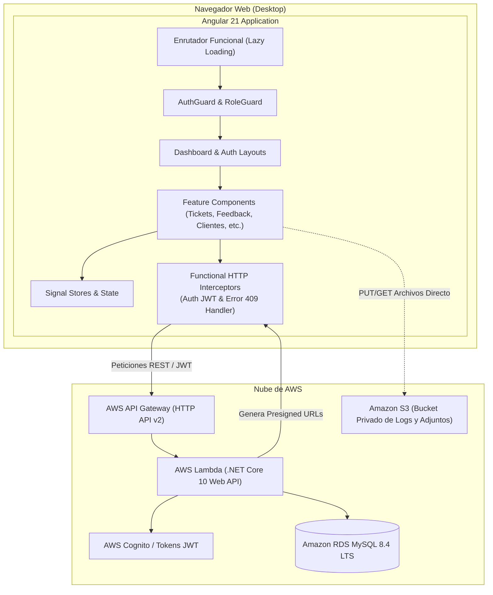

# Especificación Técnica de Frontend Web: Angular 21 (PlatformOps Hub)

**Proyecto:** PlatformOps & Product Feedback Hub — Portal Integrado de Operaciones y Feedback  
**Empresa:** TuNegocio.pe (Proveedor SaaS de Facturación Electrónica y Operaciones)  
**Institución:** Instituto de Educación Superior IDAT — VI Ciclo (Carrera de Desarrollo de Sistemas)  
**Frontend Web:** Angular 21 (Standalone Components, Signals, Control Flow moderno) + Tailwind CSS  
**Backend:** AWS Lambda (.NET Core 10) + AWS API Gateway HTTP API v2  
**Base de Datos:** Amazon RDS for MySQL 8.4 LTS (`opshub_db`, 30 tablas)  
**Almacenamiento:** Amazon S3 (Bucket privado con Presigned URLs)  

---

## 1. Visión y Alcance

El **Portal Web en Angular** constituye la consola central administrativa y operativa de escritorio para TuNegocio.pe, complementando la aplicación móvil (React Native) con capacidades avanzadas de gestión, tableros Kanban interactivos, analítica de SLA, gestión de catálogos y visión 360° de clientes.

### 1.1. Objetivos Técnicos Clave
1. **Arquitectura Reactiva y Moderna:** Adopción de **Angular 21** con **Standalone Components** y **Angular Signals** (`signal`, `computed`, `effect`) para reactividad granular y Change Detection `OnPush`.
2. **Consistencia Visual Corporativa:** Implementación estricta del Design System **Obsidian Telemetry** (`design/DESIGN.md`) con Tailwind CSS en modo oscuro de alta precisión para operaciones técnicas.
3. **Resiliencia y Concurrencia:** Integración con el mecanismo de bloqueo optimista (`version` / `HTTP 409 Conflict`) del backend .NET 10 mediante diálogos interactivos de resolución.
4. **Almacenamiento Eficiente:** Carga y visualización de logs y capturas multimedia directo contra Amazon S3 a través de URLs prefirmadas.
5. **Seguridad y RBAC:** Control de acceso granular por roles (`ADMIN`, `AGENTE_SOPORTE`, `DEV_INGENIERO`, `EJECUTIVO_VENTAS`, `MARKETING_LEAD`) protegido por interceptores y route guards funcionales.

---

## 2. Diagrama de Arquitectura de la Aplicación Web



---

## 3. Estructura de Proyecto Propuesta (`projects/web/`)

```text
projects/web/
├── src/
│   ├── app/
│   │   ├── core/                        # Núcleo de la aplicación (Singletons)
│   │   │   ├── guards/                  # auth.guard.ts, role.guard.ts
│   │   │   ├── interceptors/            # auth.interceptor.ts, error.interceptor.ts
│   │   │   ├── models/                  # Contratos TypeScript de backend
│   │   │   └── services/                # auth.service, api.service, s3-upload.service
│   │   │
│   │   ├── shared/                      # Componentes UI reutilizables
│   │   │   ├── components/              # badge, button, card, modal, conflict-dialog, data-table
│   │   │   └── pipes/                   # time-ago, currency-format
│   │   │
│   │   ├── layouts/                     # Layouts principales
│   │   │   ├── auth-layout/             # Vista de login minimalista
│   │   │   └── dashboard-layout/        # Barra lateral + Topbar + Contenido principal
│   │   │
│   │   ├── features/                    # Módulos de negocio (Lazy Loaded)
│   │   │   ├── auth/                    # Control de acceso e identidad
│   │   │   │   ├── login/               # Iniciar sesión corporativa con JWT y 1-click por rol
│   │   │   │   └── register/            # Auto-registro con catálogo de departamentos y AWS Cognito
│   │   │   ├── dashboard/               # Resumen ejecutivo de turno y KPIs
│   │   │   ├── tickets/                 # Core de incidentes (lista, creación con S3, detalle 360°, HTTP 409)
│   │   │   ├── feedback/                # Peticiones de producto, votos y Kanban Roadmap (CDK Drag)
│   │   │   ├── clients/                 # Empresas SaaS, contactos autorizados y Ficha 360° (Churn)
│   │   │   ├── announcements/           # Comunicados de sistema, alertas operativas y Changelogs
│   │   │   ├── operations/              # SLAs por plan, turnos de guardia y auditoría forense de logs
│   │   │   └── admin/                   # Aprovisionamiento de usuarios, departamentos y matriz RBAC
│   │   │
│   │   ├── app.routes.ts                # Configuración de rutas con Lazy Loading
│   │   └── app.config.ts                # Proveedores principales (provideHttpClient, provideRouter)
│   │
│   ├── environments/                    # Variables de entorno (conmutables dev/prod)
│   │   ├── environment.ts               # AWS Cloud: https://193b69gfya.execute-api.us-east-2.amazonaws.com/api/v1
│   │   └── environment.prod.ts          # AWS Cloud: https://193b69gfya.execute-api.us-east-2.amazonaws.com/api/v1
│   ├── assets/                          # Recursos gráficos
│   └── styles.css                       # Variables Obsidian Telemetry y Tailwind CSS
├── aws-frontend-template.yaml           # Infraestructura CloudFormation (S3 + OAC + CloudFront)
├── deploy-web-s3.ps1                    # Script PowerShell de compilación y despliegue a AWS
├── angular.json
├── tailwind.config.js
└── package.json
```

---

## 4. Estado de Implementación por Sprints y Módulos

| Módulo / Sprint | Componentes Clave | Estado Técnico |
|---|---|:---:|
| **Módulo 1: Acceso, Auth & RBAC** | `LoginComponent`, `RegisterComponent`, `UserManagementComponent`, `AuthService`, `OrganizationService`, `authInterceptor`, `guestGuard`, `authGuard`, `roleGuard` (protección estricta de `/admin/users`). Interfaz limpia con ojo estándar SVG y cuentas demo colapsables. | ✅ 100% Completado |
| **Módulo 2: Clientes SaaS & Ficha 360°** | `ClientListComponent`, `Client360Component`, `ClientService`, Semáforo Churn, Contactos Autorizados (RU06), Notas Comerciales (RU23/RU27). Persistencia y lectura 100% en Amazon RDS MySQL. | ✅ 100% Completado |
| **Módulo 3: Core de Incidentes (Tickets)** | `TicketListComponent`, `TicketFormComponent`, `TicketDetailComponent`, `ConflictDialogComponent`, `TicketService`, Bloqueo Optimista (HTTP 409 Conflict), Subida S3 a `us-east-2`. Persistencia en base de datos cloud. | ✅ 100% Completado |
| **Módulo 4: Feedback & Roadmap Kanban** | `KanbanRoadmapComponent`, `FeedbackService`, Tablero Kanban con `@angular/cdk/drag-drop`, Matriz RICE con scoring y ordenamiento dinámico por ARR ($). | ✅ 100% Completado |
| **Módulo 5: Avisos & Changelog** | `AnnouncementsComponent`, `AnnouncementService`, Banners de Alerta Operativa, Línea de Tiempo de Releases y Notas de Versión sincronizadas con backend. | ✅ 100% Completado |
| **Módulo 6: Operaciones & Auditoría** | `OperationsComponent`, `DashboardComponent`, `OperationsService`, Desglose dinámico de SLA por plan SaaS, Telemetría viva de 6 servicios AWS en `us-east-2 (Ohio)` con Amazon API Gateway v2, Visor forense de `logs_actividad`. | ✅ 100% Completado |
| **Cloud Deployment (Fase 7)** | `aws-frontend-template.yaml` desplegado en AWS CloudFormation. Aprovisionado S3 privado `opshub-web-prod-870550636989` con OAC + CloudFront CDN `https://d77t0uv3b5km5.cloudfront.net` con reescritura SPA y control estricto de caché. | ✅ 100% Desplegado en Producción |

---

## 5. Arquitectura de Conectividad Cloud y Resiliencia

El frontend opera en modo de **alta disponibilidad y resiliencia transparente**:
1. **Modo Online en Producción (.NET 10 en AWS Lambda + Amazon RDS + AWS Cognito):** Toda petición (`login`, `register`, `tickets`, `clients`, `feedback`, `operations`) se procesa a través de la Web API serverless (`https://193b69gfya.execute-api.us-east-2.amazonaws.com/api/v1`). La base de datos relacional MySQL 8.4 LTS (`idat-db.c74eeukcmp7z.us-east-2.rds.amazonaws.com`) almacena las transacciones y AWS Cognito gestiona las identidades en la nube (`us-east-2_5QCZKDuMi`).
2. **Modo Offline / Resiliencia:** Si la conexión a la API sufriera alguna interrupción temporal (`status === 0`), los interceptores y servicios activan un fallback transparente con `localStorage` y datos semilla, permitiendo que el evaluador o usuario interactúe con el portal sin bloqueos de pantalla blanca.
3. **Control Estricto de RBAC (Role-Based Access Control):**
   * **Ruta `/admin/users`:** Protegida con `roleGuard` (`data: { roles: ['ADMIN'] }`). Si un usuario no administrador intenta acceder, es interceptado y redirigido al Dashboard.
   * **Navegación Dinámica:** En `DashboardLayoutComponent`, el enlace a "Usuarios & Organización" se condiciona a `@if (isAdmin())` tanto en el menú de escritorio como en el menú móvil.
   * **Componente de Usuarios:** Botones de creación (`+ Nuevo Colaborador`, `+ Nuevo Departamento`) y métodos de mutación están bloqueados para roles no privilegiados.

---

## 6. Estrategia de Caché y Despliegue en Amazon CloudFront

Para garantizar que el navegador siempre cargue la versión más reciente del portal sin exigir limpiezas manuales de caché por parte del usuario:

1. **HTML Principal (`index.html`):**
   * Configurado en S3 con cabeceras estrictas de no-almacenamiento:
     ```http
     Cache-Control: max-age=0, no-cache, no-store, must-revalidate
     ```
   * Cada vez que un usuario ingresa al portal o navega, el navegador valida inmediatamente contra CloudFront y descarga el `index.html` actualizado.
2. **Bundles JS/CSS e Imágenes con Hash Criptográfico:**
   * Angular compila los artefactos asignando un hash en el nombre del archivo (ej. `main-HGTSMEAQ.js`, `styles-EYCIIBXE.css`).
   * Estos archivos se sincronizan a S3 con:
     ```http
     Cache-Control: max-age=31536000, public, immutable
     ```
   * Al ser inmutables, se almacenan en la caché del navegador por 1 año, logrando tiempos de carga sub-segundo sin riesgo de colisión al desplegar nuevas versiones.
3. **Invalidación Global en CloudFront:**
   * Con cada despliegue, el pipeline ejecuta `aws cloudfront create-invalidation --distribution-id E1NB5VA2SGWSPS --paths "/*"`, purgando de inmediato las copias intermedias en todos los Edge Locations a nivel mundial.
4. **URLs de Producción:**
   * **Portal Web Corporativo:** [https://d77t0uv3b5km5.cloudfront.net](https://d77t0uv3b5km5.cloudfront.net)
   * **Backend API Gateway:** `https://193b69gfya.execute-api.us-east-2.amazonaws.com/api/v1`
