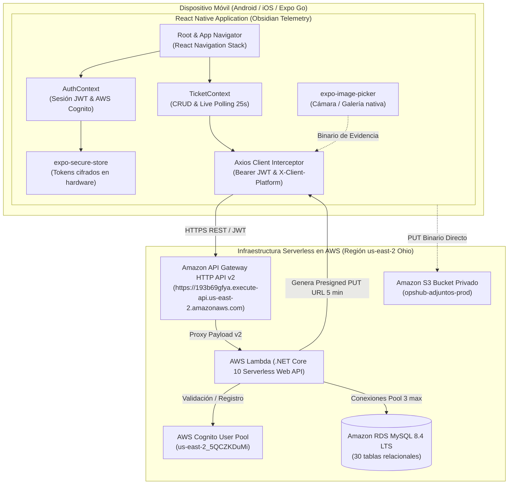

# Especificación Técnica de Aplicación Móvil: React Native & Expo (PlatformOps Hub)

**Proyecto:** PlatformOps & Product Feedback Hub — Aplicación Operativa Móvil (*TuNegocio.pe*)  
**Tecnología Móvil:** React Native 0.88 | Expo SDK 58 | TypeScript 6 | React Navigation Stack | Context API + useReducer  
**Backend:** AWS Lambda (.NET Core 10 Serverless Web API) | AWS API Gateway HTTP API v2  
**Base de Datos:** Amazon RDS MySQL 8.4 LTS Multi-AZ (`opshub_db`, 30 tablas)  
**Almacenamiento Multimedia:** Amazon S3 (Bucket privado con Presigned URLs en `us-east-2`)  
**Identidad & Seguridad:** AWS Cognito User Pool (`us-east-2_5QCZKDuMi`) + Tokens JWT  
**Institución:** Instituto de Educación Superior IDAT — VI Ciclo (Carrera de Desarrollo de Sistemas)  
**Propósito del Documento:** Guía técnica formal para el desarrollo y manual de sustentación académica ante jurado calificador.

---

## 1. Visión General y Justificación de Arquitectura Móvil

La aplicación móvil de **PlatformOps Hub** proporciona a los ingenieros de guardia, agentes de soporte técnico en campo, ejecutivos comerciales y líderes de producto de *TuNegocio.pe* una herramienta táctil de alta disponibilidad para la supervisión y resolución de incidentes críticos (P1/P2), la gestión de cuentas SaaS y la captación de feedback en tiempo real.



### 1.1. Complementariedad: Mobile vs Portal Web Angular 21
Frente al Portal Web de escritorio (orientado a análisis intensivo, tableros Kanban con Drag & Drop y auditoría tabular), la aplicación móvil prioriza:
1. **Atención Inmediata de Incidencias Críticas (P1/P2):** Notificación visual reactiva, filtros instantáneos y actualización de estado en menos de 3 toques de pantalla.
2. **Captura Directa de Evidencias con Hardware:** Uso de la cámara del smartphone para fotografiar pantallas congeladas, tickets físicos de impresión térmica desalineados o errores de POS, subiéndolos de inmediato a Amazon S3 vía URLs prefirmadas.
3. **Acciones Rápidas Táctiles sobre Clientes SaaS:** Marcación telefónica directa (`tel:+51...`) al contacto técnico de empresas con riesgo de churn desde la ficha del cliente.
4. **Votación Táctil de Feedback:** Los ejecutivos comerciales en reuniones pueden registrar votos de clientes con 1 toque sobre sugerencias de producto, recalculando el ARR impactado.

---

## 2. Comparativa y Alineación de Menús: Web Desktop vs App Móvil

| Módulo del Hub | Enfoque en Portal Web (Angular 21) | Enfoque Adaptado en Móvil (React Native) | Justificación de Diseño UX/UI |
|---|---|---|---|
| **1. Autenticación & Acceso** | Formulario completo + Cuentas demo colapsables + Guards funcionales en URL. | Pantalla minimalista con autocompletado rápido por rol (DEV, Soporte, Ventas, MKT, Admin). | Agiliza pruebas en dispositivos físicos sin teclado físico. |
| **2. Incidentes (Tickets)** | Tabla con paginación, filtros combinados y Drawer lateral de detalle 360°. | Lista táctil con chips de filtro rápido (P1, P2, Diagnóstico), Pull-to-Refresh y vista de detalle dedicada. | Ergonomía táctil móvil y scroll infinito vertical fluido. |
| **3. Bloqueo Optimista (HTTP 409)** | Diálogo modal con diff de versiones y recarga automática. | Modal interactivo de alerta de concurrencia que muestra versión local vs versión del servidor y botón de sincronización. | Previene colisiones cuando un técnico en campo y otro en oficina editan el mismo ticket. |
| **4. Multimedia & Adjuntos** | Drag & drop de archivos en navegador con Presigned URLs a S3. | Integración nativa con `expo-image-picker` (cámara o galería) + subida binaria con `expo-file-system`. | Acceso a sensores de hardware fotográfico del dispositivo. |
| **5. Clientes SaaS & Ficha 360°** | Tabla de empresas, métricas de retención, semáforo Churn y notas comerciales. | Tarjetas resumen con Health Score, Churn Risk y botones rápidos de llamada telefónica y correo. | Acceso inmediato a comunicación con clientes en movilidad. |
| **6. Feedback & Roadmap** | Tablero Kanban con `@angular/cdk/drag-drop` por columnas de fases de desarrollo. | Feed ordenado por votos e impacto ARR con botón interactivo de Upvote (`toggleVote`). | En pantallas móviles el drag & drop horizontal resulta incómodo; el feed vertical optimiza la lectura. |
| **7. Avisos & Telemetría Cloud** | Visor de métricas en topbar y panel de 6 servicios AWS con latencias. | Pantalla segmentada por Tabs ("Avisos", "AWS Cloud", "Changelog") con telemetría en vivo. | Simplifica la inspección de servidores AWS en pantallas de 6 pulgadas. |

---

## 3. Estructura del Proyecto Móvil (`projects/mobile/`)

```text
projects/mobile/
├── assets/                          # Iconos, splash screens y fuentes Obsidian
├── src/
│   ├── api/                         # Capa de comunicación remota con AWS
│   │   ├── client.ts                # Instancia Axios con interceptor JWT y base URL de AWS
│   │   ├── authApi.ts               # Autenticación, registro, perfil /me y catálogo deptos
│   │   ├── ticketsApi.ts            # CRUD de tickets, concurrencia 409 y presigned URLs S3
│   │   ├── clientsApi.ts            # Directorio de clientes SaaS y contactos autorizados
│   │   ├── feedbackApi.ts           # Backlog de sugerencias de producto y toggle de votos
│   │   ├── announcementsApi.ts      # Alertas operativas, mantenimientos y changelog
│   │   └── operationsApi.ts         # Métricas de SLA y telemetría de salud de servicios AWS
│   │
│   ├── components/                  # Componentes reutilizables Obsidian Telemetry
│   │   ├── Button.tsx               # Botón primario, secundario y de peligro con spinner
│   │   ├── InputText.tsx            # Input estilizado con validación visual y alternador Eye / EyeOff
│   │   ├── PriorityBadge.tsx        # Píldora de severidad (P1 Crítico a P4 Baja)
│   │   ├── StatusBadge.tsx          # Píldora de estado del ticket con dot reactivo
│   │   └── TicketCard.tsx           # Tarjeta de incidencia con código, cliente y versión
│   │
│   ├── context/                     # Manejadores de estado global reactivo
│   │   ├── AuthContext.tsx          # Estado de usuario, JWT, restauración y verificación /me
│   │   └── TicketContext.tsx        # useReducer + Context API con Live Polling silencioso
│   │
│   ├── navigation/                  # Enrutamiento nativo con React Navigation
│   │   ├── RootNavigator.tsx        # Selector condicional (AuthNavigator vs AppNavigator)
│   │   ├── AuthNavigator.tsx        # Stack de Login y Register
│   │   └── AppNavigator.tsx         # Stack principal (Home, TicketList, Detail, Form, Clients, Feedback, Announcements)
│   │
│   ├── screens/                     # Vistas de la aplicación móvil
│   │   ├── HomeScreen.tsx           # Dashboard central, KPIs, conectividad AWS y menú
│   │   ├── LoginScreen.tsx          # Autenticación corporativa y selector de 1-clic por rol
│   │   ├── RegisterScreen.tsx       # Onboarding con catálogo dinámico de departamentos
│   │   ├── TicketListScreen.tsx     # Bandeja de tickets con chips de filtro y búsqueda
│   │   ├── TicketDetailScreen.tsx   # Detalle 360°, comentarios, resolución de conflicto 409
│   │   ├── TicketFormScreen.tsx     # Reporte de incidencia con cámara y subida a Amazon S3
│   │   ├── ClientsScreen.tsx        # Directorio SaaS, riesgo Churn y llamada táctil
│   │   ├── FeedbackScreen.tsx       # Peticiones de producto con votación interactiva
│   │   └── AnnouncementsScreen.tsx  # Alertas activas, telemetría AWS en caliente y changelog
│   │
│   ├── types/                       # Contratos de datos TypeScript alineados al Backend
│   │   ├── auth.ts                  # User, UserRole, RegisterData, ApiResponse<T>
│   │   ├── ticket.ts                # Ticket, Priority, Status, UpdateInput, PresignedUrlResponse
│   │   ├── client.ts                # ClientSaas, ClientContact
│   │   ├── feedback.ts              # SugerenciaProducto
│   │   ├── announcements.ts         # ComunicadoSistema, ChangelogRelease
│   │   ├── operations.ts            # ServiceHealth, SlaSummary, PlanSlaBreakdown
│   │   └── navigation.ts            # ParamList de stacks de navegación
│   │
│   └── utils/
│       └── storage.ts               # Abstracción segura de almacenamiento (SecureStore / Web)
│
├── App.tsx                          # Punto de entrada de la aplicación con Providers anidados
├── app.json                         # Configuración Expo SDK 58 y metadatos nativos
├── package.json                     # Dependencias (React 19, React Native 0.88, Axios)
└── tsconfig.json                    # Compilador TypeScript estricto
```

---

## 4. Arquitectura de Datos en Tiempo Real y Resiliencia

Dado que la arquitectura de backend está desplegada en **AWS Lambda bajo HTTP API v2** (serverless sin sockets TCP de larga duración para optimizar costos), la sincronización en tiempo real se implementa mediante un patrón híbrido de alta eficiencia:

### 4.1. Live Reactive Polling Silencioso
* En `TicketContext.tsx`, al montar la aplicación se inicializa un temporizador periódico de **25 segundos**:
  ```typescript
  pollingRef.current = setInterval(() => {
    fetchTickets(false); // Modo silencioso: sincroniza datos sin parpadeo de loaders
  }, 25000);
  ```
* **Optimización de Batería y Red:** Si la lista de datos ya existe, las peticiones en segundo plano ejecutan la acción `SILENT_SYNC` en el reducer, actualizando la memoria y la estampa de tiempo (`lastUpdated`) sin alterar la posición del scroll ni interrumpir la interacción del usuario.

### 4.2. Pull-to-Refresh Táctil
* Cada vista principal (`HomeScreen`, `TicketListScreen`, `ClientsScreen`, `FeedbackScreen`, `AnnouncementsScreen`) implementa el componente nativo `RefreshControl` con feedback háptico y color primario `#6366F1`.
* Al deslizar hacia abajo, el cliente invalida la caché local y reconsulta los datos frescos desde Amazon RDS MySQL.

### 4.3. Actualizaciones Optimistas de Interfaz (Optimistic UI Updates)
* En la pantalla de **Feedback**, cuando el usuario presiona el botón de votación, el contador se incrementa instantáneamente en pantalla ($+1$) y cambia de color antes de recibir la confirmación de la red. Si la petición fallara, el estado revierte automáticamente al valor previo.

### 4.4. Resiliencia y Modo Offline
* Si el dispositivo pierde la señal de red o ingresa a un sótano sin cobertura celular (`Network Error` / `ECONNABORTED`), la capa API conmuta a un estado de **resiliencia local transparente**:
  * Continúa permitiendo navegar la bandeja con los últimos datos sincronizados.
  * Los selectores de departamentos y cuentas de prueba permiten seguir operando en modo simulado para presentaciones o pruebas sin conexión.

### 4.5. Fluidez Visual sin Destellos Blancos (Zero White-Flash Transitions)
* En aplicaciones con tema oscuro de alta precisión (Obsidian Telemetry), un problema común de React Navigation es el destello blanco durante el desapilado de pantallas (`navigation.goBack()`), originado por el `DefaultTheme` interno del contenedor de navegación y la ventana nativa de Android.
* Se blindaron todas las capas subyacentes con `#0F172A`:
  1. `NavigationContainer` inyectado con `theme={CustomDarkTheme}` (`colors.background: '#0F172A'`).
  2. Ventana de actividad nativa configurada en `app.json` (`userInterfaceStyle: "dark"`, `backgroundColor: "#0F172A"`).
  3. Contenedores raíz en `App.tsx` y `RootNavigator.tsx` con fondo estricto `#0F172A`.
  4. En entornos web, sincronización del `document.body.style.backgroundColor = '#0F172A'`.
  * **Resultado:** Las transiciones de retroceso deslizan de forma continua y suave sin interrupciones visuales de color blanco.

---

## 5. Patrones de Ingeniería Avanzados Implementados en Mobile

### 5.1. Bloqueo Optimista (Optimistic Locking) y Resolución de HTTP 409 Conflict
* **Problema en Soporte de Campo:** Dos ingenieros pueden abrir simultáneamente el mismo ticket crítico en sus teléfonos móviles y cambiar el estado (por ejemplo, uno pasa a `RESUELTO` y otro a `EN_DESARROLLO`).
* **Solución Técnica:**
  1. Cada ticket expone su número de versión `version: number`.
  2. Al presionar "Guardar Cambios", la app móvil envía:
     ```json
     {
       "nuevoEstadoId": 5,
       "currentVersion": 2,
       "comentario": "Hotfix aplicado en contenedor"
     }
     ```
  3. En MySQL, EF Core ejecuta la sentencia atómica `WHERE id = @id AND version = @currentVersion`.
  4. Si otro usuario modificó el ticket milisegundos antes, el backend responde **`HTTP 409 Conflict`** con el mensaje de colisión.
  5. En `TicketDetailScreen.tsx`, el bloque `catch` detecta el código 409 y despliega el **Modal de Conflicto de Concurrencia**:
     * Advierte al usuario que los datos fueron alterados por otro operador.
     * Ofrece el botón "Recargar y Ver Cambios Remotos" para sincronizar la versión más reciente del servidor sin corromper la base de datos.

### 5.2. Carga Multimedia Directa a Amazon S3 (Presigned URLs)
* **Problema:** Enviar imágenes fotográficas pesadas de errores directamente a través de AWS Lambda agota la memoria asignada (1024 MB), puede exceder el límite estricto de 10 MB de API Gateway y genera cobros innecesarios de cómputo serverless.
* **Solución Técnica:**
  1. El usuario toma una fotografía con la cámara usando `expo-image-picker`.
  2. La app móvil solicita autorización a la API: `POST /api/v1/tickets/{id}/attachments/presigned-url` con el nombre del archivo y tipo MIME (`image/jpeg`).
  3. El backend firma criptográficamente una URL de S3 con verbo `PUT` y vigencia estricta de **5 minutos**.
  4. La app móvil transmite el binario directamente a Amazon S3 usando `expo-file-system` (`FileSystem.uploadAsync` con `BINARY_CONTENT`).
  5. Una vez confirmado el almacenamiento en S3, se notifica al backend para guardar los metadatos en la tabla `ticket_adjuntos`.

### 5.3. Onboarding Seguro Multiplataforma y Validación de Credenciales
* Para evitar que un usuario malicioso que use la app móvil intente asignarse un rol de Administrador en el formulario de registro:
  1. La app móvil consume el catálogo público `GET /api/v1/catalogs/departamentos`.
  2. El colaborador **únicamente selecciona su departamento** (ej. TI & Desarrollo, Soporte Técnico, Ventas).
  3. El servidor asigna en backend el rol base de menor privilegio correspondiente (ej. `DEV_INGENIERO` o `AGENTE_SOPORTE`).
  4. Los roles administrativos no se exponen en la interfaz cliente móvil (OWASP Top 1: Broken Access Control).
* **Confirmación de Contraseña y Validación Reactiva (Paridad con Web):**
  * En `RegisterScreen.tsx`, se integró el campo obligatorio "Confirmar Contraseña" con validación Zod cruzada:
    ```typescript
    .refine((data) => data.password === data.confirmPassword, {
      message: 'Las contraseñas no coinciden',
      path: ['confirmPassword'],
    })
    ```
  * En `InputText.tsx`, el control de visibilidad de contraseñas sustituyó la etiqueta textual "VER"/"OCULTAR" por iconos SVG interactivos (`Eye` y `EyeOff` de `lucide-react-native`), optimizando el espacio visual y la ergonomía táctil.

### 5.4. Almacenamiento Seguro de Credenciales y Tokens JWT
* En dispositivos Android e iOS, el token de sesión no se guarda en texto plano (`AsyncStorage`).
* Se utiliza **`expo-secure-store`**, que almacena el token cifrado utilizando el **Android KeyStore** o el **iOS Keychain** del hardware del teléfono.
* Toda petición enviada por `apiClient` inyecta automáticamente la cabecera:
  ```http
  Authorization: Bearer <jwt_token>
  X-Client-Platform: REACT_NATIVE_ANDROID
  ```
  Permitiendo que el interceptor de auditoría del backend (`logs_actividad`) registre forensemente que la transacción se originó desde la aplicación móvil.

### 5.5. Reducción de Sobrecarga Cognitiva y Copywriting Centrado en el Usuario
* En las pantallas operativas principales (`LoginScreen`, `RegisterScreen`, `HomeScreen`, `TicketDetailScreen`, `TicketFormScreen`), se depuraron textos internos, notas de arquitectura en la nube y términos académicos que generaban confusión al usuario final.
* Las notificaciones técnicas complejas se transformaron en mensajes claros de orientación:
  * El banner de estado en el Home indica: *"SISTEMA EN LÍNEA • Conexión activa • Sincronizado a las HH:mm:ss"*.
  * El diálogo de conflicto de concurrencia HTTP 409 se presenta como: *"Incidencia Actualizada: Otro miembro del equipo acaba de actualizar esta incidencia. Deseas recargar para ver la información más reciente?"*.
  * El selector de credenciales de prueba se titula amigablemente: *"Cuentas de prueba rápidas"*.
* Toda la telemetría detallada de servicios AWS e infraestructura en la nube se encuentra debidamente aislada en la pantalla especializada de diagnóstico (`AnnouncementsScreen.tsx`).

---

## 6. Estrategia de Compilación y Generación de Instaladores Android (.APK)

Para distribuir la aplicación a los evaluadores del jurado, técnicos en campo o clientes sin requerir publicación inmediata en Google Play Store:

### 6.1. Método Oficial Recomendado: EAS Build en la Nube (Expo Application Services)
* **Ventaja:** No requiere instalar Android Studio, Java 17, NDK ni configurar variables de entorno locales de compilación. Todo el proceso de ensamblado se ejecuta en los servidores dedicados de Expo en la nube.
* **Configuración (`eas.json`):**
  Se definió el perfil `preview` con `"buildType": "apk"`:
  ```json
  {
    "build": {
      "preview": {
        "distribution": "internal",
        "android": {
          "buildType": "apk"
        }
      }
    }
  }
  ```
* **Comandos de Generación:**
  ```bash
  # 1. Instalar la herramienta EAS CLI globalmente (una sola vez)
  npm install -g eas-cli

  # 2. Iniciar sesión en Expo (cuenta gratuita en expo.dev)
  eas login

  # 3. Vincular el proyecto con Expo Cloud
  eas project:init

  # 4. Lanzar la compilación en la nube para generar el archivo .APK
  eas build -p android --profile preview
  ```
* Al finalizar el proceso en la nube (toma entre 5 y 10 minutos), EAS devuelve un enlace de descarga directa del archivo `.apk` y un código QR para escanear e instalar directamente en cualquier teléfono Android.

### 6.2. Método Alternativo: Prebuild y Compilación Local con Android Studio
* Si se cuenta con Android Studio y Android SDK configurados localmente:
  ```bash
  # Generar la carpeta nativa android/
  npx expo prebuild --platform android

  # Compilar el APK en modo Release localmente
  cd android
  ./gradlew assembleRelease
  ```
* El binario ejecutable se genera en: `android/app/build/outputs/apk/release/app-release.apk`.

---

## 7. Guía de Sustentación para el Jurado Calificador (IDAT VI Ciclo)

### Preguntas Técnicas Frecuentes y Respuestas de Defensa

#### 1. ¿Cómo se comunican la aplicación móvil, el portal web y el backend?
> *"Tanto la aplicación móvil en React Native como el portal web en Angular consumen la misma Web API REST serverless alojada en AWS Lambda bajo Amazon API Gateway v2 HTTP API (`us-east-2`). La autenticación se unifica mediante tokens JWT emitidos y validados contra AWS Cognito y nuestra base de datos Amazon RDS MySQL 8.4 LTS, garantizando que cualquier cambio realizado desde el celular se refleje de inmediato en la web y viceversa."*

#### 2. ¿Cómo manejan el problema de concurrencia en la app móvil cuando dos técnicos editan el mismo ticket?
> *"Implementamos Bloqueo Optimista (Optimistic Locking). Cada ticket tiene una propiedad `version`. Cuando guardamos cambios desde el celular, enviamos la versión que teníamos leída. Si alguien la modificó antes en la web o en otra app, el backend retorna `HTTP 409 Conflict`. La app móvil intercepta el 409 y levanta un modal de advertencia que impide sobreescribir los datos ajenos y permite sincronizar la versión más reciente del servidor con un solo toque."*

#### 3. ¿Por qué la app móvil no sube las fotos del fallo técnico directamente al backend?
> *"Porque en arquitecturas serverless como AWS Lambda, procesar archivos multimedia pesados satura la memoria de la función y API Gateway tiene un límite de payload de 10 MB. La app móvil solicita al backend una URL prefirmada de Amazon S3 válida por 5 minutos y luego sube la imagen de forma binaria directo al bucket de S3 con `expo-file-system`. El backend nunca procesa el binario, logrando costo cero y máxima velocidad."*

#### 4. ¿Por qué la app móvil no tiene exactamente el mismo menú que la página web?
> *"Porque el diseño debe responder a la ergonomía del usuario. En la web de escritorio contamos con monitores grandes para tableros Kanban con drag-and-drop y tablas de auditoría detalladas. En el teléfono móvil el usuario necesita movilidad: hemos adaptado el menú a un Hub operativo táctil con accesos directos a incidentes, marcación telefónica directa a contactos de clientes SaaS para evitar su cancelación (Churn), feed de votación rápida de requerimientos por impacto económico (ARR) y telemetría de salud de los servicios de AWS."*

#### 5. ¿Cómo garantizan que la app móvil funcione si no hay internet o si el backend está en mantenimiento?
> *"Diseñamos la capa de servicios con el principio de degradación elegante (Graceful Degradation). Si la petición a AWS Lambda falla por tiempo de espera o caída de red (`status === 0`), los interceptores activan un fallback local transparente con datos semilla de demostración y almacenamiento seguro, permitiendo al usuario interactuar con la interfaz sin experimentar pantallas blancas ni bloqueos de la aplicación."*

#### 6. ¿Dónde se almacenan las credenciales y el token JWT en el dispositivo móvil?
> *"Para cumplir con los estándares de seguridad de OWASP Mobile, no almacenamos los tokens en texto plano dentro de AsyncStorage. Utilizamos `expo-secure-store`, que se integra con el Secure Enclave / Keychain en iOS y el Android KeyStore respaldado por hardware, asegurando que el token no pueda ser extraído por aplicaciones maliciosas instaladas en el dispositivo."*
